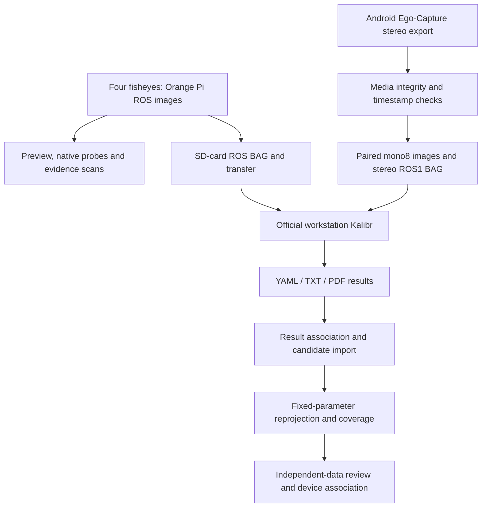

# Ego-Calib-Tools: headband capture assistance and camera calibration

See the [colleague setup and file checklist](docs/COLLEAGUE_HANDOFF.zh-CN.md)
for APK, source, SDK/NDK and Kalibr image handoff boundaries.

**Linux workstation tools for existing four-fisheye capture assistance and Android 2UQ2 stereo calibration/validation.**

[简体中文](README.md) · [Complete stereo guide](ego_stereo/README.en.md) · [Evidence/handoff](ego_stereo/STATUS-20261106.md) · [Recorder app](https://github.com/EgoOneLabs/Ego-Capture/tree/feat/android-capture-code16)

> **Work in progress.** Stereo work lives on `feat/ego-stereo-calibration`, not merged into main. Existing v1.10.4 four-camera preview/tools/daily workflows are retained. Stereo media/BAG readback and a historical DS fixed-parameter audit are complete; independent-data and full quality acceptance are not. Updated 2026-11-06. A successful script or detected target is not calibration acceptance.

## Features and progress

| Track / feature | Implemented | Verified / remaining |
|---|---|---|
| Four-camera preview and relay | Existing tools and operator documentation | Not re-tested on hardware or Docker in this update |
| Native target evidence | Kalibr probes and read-only BAG evidence scans | Assistance, not final four-camera calibration acceptance |
| Four-camera deployment/daily workflow | SD-card/ROS capture, transfer and Kalibr instructions | Check actual services, ROS master, topics and physical board |
| Stereo media validation | Full MKV/WAV decode and provenance/time checks | One real 286-frame-per-eye session checked |
| Stereo BAG preparation | Same-index paired sampling, mono8, full write/readback | Real smoke case: 36 pairs / 72 messages checked |
| Official Kalibr launcher | Config/source checks, logs and real/user/sys | Wrapper implemented; not run end-to-end on a new real target session |
| Historical DS import | YAML/TXT/PDF association and candidate profile | Associated successfully; neither activated nor uniquely unit-bound |
| Fixed-parameter audit | Mono/bidirectional cross-projection and coverage | 230/230 original pairs, independently recalculated CSV; not holdout validation |
| Camera–IMU / production acceptance | Not completed by the stereo branch | Timing, continuity, repeatability and general device acceptance remain open |

## Architecture



The new launcher is stereo-only; existing four-camera calibration follows its own instructions. Kalibr algorithms are unchanged. The audit estimates per-frame target poses while keeping intrinsics and stereo extrinsics fixed. Calibration does not run in the Android app.

## Source map and environment

| Location | Responsibility |
|---|---|
| [`preview/`](preview/) | Existing four-camera relay, native probes and BAG scans |
| [`tools/`](tools/) | Environment checks, image export and report packaging |
| [Daily workflow](docs/daily_workflow.zh-CN.txt) | Four-camera initialization, SD-card/ROS recording, transfer and calibration |
| [`ego_stereo/media/`](ego_stereo/media/) | Stereo media validation and explicitly selected ADB pull |
| [`ego_stereo/workflow/`](ego_stereo/workflow/) | Image/BAG preparation and official Kalibr invocation |
| [`ego_stereo/result_import/`](ego_stereo/result_import/) | Known DS result association and profile import |
| [`ego_stereo/quality/`](ego_stereo/quality/) | Offline fixed-parameter residuals, CSV, coverage and illustrations |
| [`ego_stereo/evidence/`](ego_stereo/evidence/) | Reviewed numeric summaries, no raw footage or scene images |

Workstation: Linux, Python3, FFmpeg/FFprobe, Git and Docker; no GPU requirement. Existing `kalibr` container: ROS Noetic, `/catkin_ws`, NumPy/OpenCV/cv_bridge/rosbag/Kalibr bindings and verified host-data bind mount to `/data`.

Stereo topics: `/cam0/image_raw`, `/cam1/image_raw`, 1920×1080 mono8, no IMU. Four-camera topics: `/fisheye/{left,right,bright,bleft}/image_raw/compressed`, verified against the actual headband. Historical AprilGrid: 6×6, 0.088m tags, 0.0264m gaps, spacing ratio 0.3; physical dimensions must be checked for new boards.

## Quick start — Linux workstation

```bash
git clone --branch feat/ego-stereo-calibration https://github.com/EgoOneLabs/Ego-Calib-Tools.git
cd Ego-Calib-Tools
```

Use the [stereo guide](ego_stereo/README.en.md) for media → camera-only BAG/readback → calibration only on new required input → quality review. For four cameras, use the [daily workflow](docs/daily_workflow.zh-CN.txt) and retained deployment guide below. Confirm ROS master/services instead of assuming camd direct recording publishes ROS topics. Source ZIPs do not contain the Docker image or input data.

## Evidence and its limits

| Check | Evidence | Does not establish |
|---|---|---|
| Existing four-camera static checks | [`docs/VALIDATION.txt`](docs/VALIDATION.txt): Python/Bash syntax; no Docker/device run | Device-level calibration success |
| Real stereo media | 286 decoded frames per eye; nonzero 48kHz stereo PCM16 WAV | Constant 30FPS or hardware synchronization |
| Native ROS smoke BAG | Full pixels/Header/time readback of 36 pairs / 72 messages | Target coverage or calibration quality |
| Historical DS association | Matching YAML/TXT/PDF; baseline ~89.271mm | Applicability to all physical units |
| Fixed-parameter audit | 230/230 common detections; cross RMS 0.818/1.047px; P95 1.453/1.678px | Independent-data generalization or full-frame acceptance |
| New tool tests | 5 workflow + 5 importer + 4 geometry tests passed | A new real calibration run |

Audit real/user/sys: ~66.381/51.352/15.042s. All 100475 CSV rows and coverage statistics were independently recalculated. The audited images were used for fitting; cam1's rightmost 1/8 has no retained target corners. Signed means near zero do not imply zero error.

## Remaining work and handoff

1. Reuse another existing target recording for one fixed-parameter independent-data check; do not refit or repeat model sweeps.
2. Review missing edge coverage, physical target scale, left/right order and unique headband-to-parameter association before final acceptance.
3. Exercise the new Kalibr launcher when a genuinely new calibration input is needed; do not rerun completed calibration only to test a wrapper.
4. Agree application-specific quality/coverage criteria; no arbitrary automatic passing threshold is introduced.
5. Preserve raw data, hashes, source/container versions, errors and real/user/sys. Do not remove identity guards to make known-data tools accept unrelated devices.
6. Keep IMU continuity, hardware timing and camera–IMU repeatability explicitly open. They do not block pure-camera workflow work.

The known DS importer/auditor are identity-locked historical tools, not universal per-device production acceptance. Update feature, evidence and open-issue tables when new results arrive. Do not modify official Kalibr algorithms or overwrite previous results.

## Licensing and contribution

This update does not change licensing. Maintainers should confirm the top-level project license and preserve applicable Kalibr/third-party/image licenses. Issues/PRs on input contracts, device management, timing and quality evidence are welcome.

---

## Retained four-camera deployment guide

Existing deployment steps and historical release-image instructions follow. The linked daily workflow remains the operational reference.

Daily collection and Kalibr operation guide (Chinese Word): [open the guide](docs/头环四鱼眼相机标定采集流程_内置SD卡版_日常快速启动版本终版.docx). A [plain-text copy](docs/daily_workflow.zh-CN.txt) is also available.
[English](README.en.md) | [简体中文](README.md)

Collection assistance for four fisheye cameras, based on preview source v1.10.4. The tool displays live previews and Kalibr native AprilGrid evidence to help an operator position the target. Preview evidence does not guarantee calibration success.

## Where things are

| Location | What it contains |
|---|---|
| [README.en.md](README.en.md) / [README.md](README.md) | English / Chinese installation, Docker import, startup and troubleshooting steps. Start here on a new workstation. |
| [Daily collection guide](docs/头环四鱼眼相机标定采集流程_内置SD卡版_日常快速启动版本终版.docx) / [text copy](docs/daily_workflow.zh-CN.txt) | Chinese operator procedure: first-time headband setup, SD-card recording, transfer and Kalibr checks. The headband IP and BAG names are examples to change for each device. |
| [docs/](docs/) | Additional quick start, validation notes, and operator guide. |
| [preview/](preview/) | Four-camera preview launcher, Python relay/probe, web display and target configuration. The `output/` directory is generated during use. |
| [tools/](tools/) | Environment check, Docker image export, and preview report packaging scripts. |
| [v1.10.4 Release](https://github.com/BAAI-Ego/headband-calibration-tools/releases/tag/v1.10.4) | Full deployment tar with the Docker image, plus its SHA256 file. These files are downloaded separately from Git source. |

Use the **Code** tab to browse these folders. Use **Releases** on the right to download the full deployment package. The daily guide covers collection and Kalibr operation; this README covers installation and use of the preview assistant.

## Before you start: what to obtain

| Item | Where | Purpose |
|---|---|---|
| This repository's `main` branch | **Code** tab or the clone command below | Current guides, daily workflow, preview source and helper scripts |
| Full `.tar` and matching `.tar.sha256` | [v1.10.4 Release Assets](https://github.com/BAAI-Ego/headband-calibration-tools/releases/tag/v1.10.4) | Approximately 1.5 GiB Kalibr Docker image and download verification |

Get both items. GitHub's automatic **Source code ZIP omits the image**. This is a private repository; your account needs read access. Follow the numbered sections on a **Linux workstation** unless a command explicitly says headband terminal. Each comment describes the command immediately below it. Stop and resolve any failed step before proceeding.

## Step 1: Prepare the workstation

Use Ubuntu/Debian x86_64 with network access. Allow roughly 20 GB for download, extraction and Docker image layers. The headband must already have its original camera drivers and ROS environment.

```bash
# Workstation: verify x86_64 (the image is linux/amd64).
uname -m
# Workstation: inspect space; allow roughly 20 GB for archive, extraction and image layers.
df -h "$HOME" /var/lib
# Workstation: update the package index.
sudo apt-get update
# Workstation: install Git, GitHub CLI, SSH and network utilities.
sudo apt-get install -y git gh openssh-client python3 unzip rsync arp-scan netcat-openbsd
```

## Step 2: Clone the main branch

Sign in to `gh` for this private repository if needed. Do not overwrite an existing clone.

```bash
# Workstation: check login; if signed out, run the interactive command below.
gh auth status
```

Only if the check reports that you are signed out:

```bash
# Workstation: authorize GitHub CLI in the browser.
gh auth login
```

Then continue:

```bash
# Workstation: enter your home directory; do not overwrite an existing clone.
cd "$HOME"
# Workstation: clone the main branch of the dedicated repository.
gh repo clone EgoOneLabs/Ego-Calib-Tools -- --branch feat/ego-stereo-calibration
# Workstation: enter the source directory.
cd "$HOME/Ego-Calib-Tools"
# Workstation: confirm the main branch.
git branch --show-current
# Workstation: check that both guides are in the repository root.
ls -l README.en.md README.md
```

If `~/Ego-Calib-Tools` already exists, inspect `git status` there and use `git pull --ff-only` only after confirming it has no local changes.

## Step 3: Download and verify the image assets

Download both assets from the Release; the source is already cloned in step 2. The commands below can be used instead of clicking Assets in the browser.

```bash
# Workstation: create a separate download directory.
mkdir -p "$HOME/Downloads/headband-v1.10.4"
# Workstation: download both release assets into it.
gh release download v1.10.4 --repo BAAI-Ego/headband-calibration-tools --dir "$HOME/Downloads/headband-v1.10.4" --pattern 'headband-calibration-assistant-v1.10.4-full.tar*'
# Workstation: enter the download directory.
cd "$HOME/Downloads/headband-v1.10.4"
# Workstation: check both asset names and sizes.
ls -lh headband-calibration-assistant-v1.10.4-full.tar*
# Workstation: verify the tar checksum; stop on mismatch.
sha256sum -c headband-calibration-assistant-v1.10.4-full.tar.sha256
# Workstation: extract into this directory; check before proceeding if the folder already exists.
tar -xf headband-calibration-assistant-v1.10.4-full.tar
# Workstation: verify all internal files, including the image archive.
cd headband-calibration-assistant-v1.10.4-full
sha256sum -c SHA256SUMS
```

The assets are `headband-calibration-assistant-v1.10.4-full.tar` and `.tar.sha256`. The archive is a release snapshot and its bundled README has older filenames. **Use the current README and operator guide from the cloned `main` branch.** The archive provides `environment/kalibr-environment.tar.gz` for import.

## Step 4: Install Docker and import the Kalibr image

Keep an existing Docker installation. Resolve `docker info` permission errors with the workstation administrator and log in again before proceeding. If `kalibr:noetic` already points to a different image, investigate before changing its tag.

```bash
# Workstation: install and start docker.io only when Docker is absent; do not mix it with Docker CE.
if ! command -v docker >/dev/null; then sudo apt-get install -y docker.io; sudo systemctl start docker; fi
# Workstation: confirm the current user can use Docker directly.
docker info
# Workstation: inspect any existing tag; a missing-image error is acceptable, but stop if the ID differs.
docker image inspect kalibr:noetic --format '{{.Id}} {{.Os}}/{{.Architecture}}'
# Workstation: inspect the expected image identity and platform.
cat environment/image-id-platform.txt
# Workstation: verify the image archive again.
(cd environment && sha256sum -c SHA256SUMS)
# Workstation: import only after resolving any different pre-existing kalibr:noetic tag.
docker load -i environment/kalibr-environment.tar.gz
# Workstation: confirm the imported image identity and platform.
docker image inspect kalibr:noetic --format '{{.Id}} {{.Os}}/{{.Architecture}}'
# Workstation: return to the current source repository.
cd "$HOME/Ego-Calib-Tools"
# Workstation: check local dependencies without connecting to the headband.
bash tools/check_preview_environment.sh
```

Expected image ID: `sha256:ddbe45d2bd03e8a415688355dc23c4ceedf6eb576e1c6d7eeafa51567fa10b29`, platform `linux/amd64`. Expected dependency result: `DEPENDENCIES_PASS`. The administrator should decide whether to grant Docker group access, which carries elevated privileges. No host ROS install is needed; do not replace compiled Kalibr bindings with pip.

Next, follow step 5 to identify the actual headband IP and inspect all four image topics, then run a 60-second preview in step 6. The SSH relay adds load; it does not start the original BAG recording.

## Step 5: Find and check the headband

The headband must already have ROS Noetic, OpenCV, NumPy, and the original four-camera service/driver. This package does not install headband firmware. Connect one headband at a time. Replace the interface, subnet, and IP below with actual values.

```bash
# Linux workstation
sudo arp-scan --interface=eno1 192.168.10.0/24
# Verify the device's SSH fingerprint before accepting it.
ssh orangepi@192.168.10.109
```

```bash
# Headband terminal
source /opt/ros/noetic/setup.bash
export ROS_MASTER_URI=http://localhost:11311
systemctl is-active seeker_cam_bridge.service
for TOPIC in /fisheye/left/image_raw/compressed /fisheye/right/image_raw/compressed /fisheye/bright/image_raw/compressed /fisheye/bleft/image_raw/compressed; do
  if timeout 8 rostopic echo -n 1 "$TOPIC" >/dev/null; then
    echo "PASS $TOPIC"
  else
    echo "FAIL $TOPIC"
  fi
done
exit
```

All four topics must pass. The checks briefly subscribe to image messages and add temporary load. SSH connectivity alone does not prove bidirectional ROS connectivity.

## Step 6: Start the assistant

Linux workstation, full package root:

```bash
cd preview
# Arguments: actual headband IP, workstation wired IP, preview profile
bash run_temporary_four_preview.sh 192.168.10.109 192.168.10.10 balanced
```

Open http://127.0.0.1:8766 in a browser. Default order: BRIGHT, RIGHT, LEFT, BLEFT in one row. The balanced profile targets 5 preview FPS at width 640; this is not the camera recording frequency. An optional fourth argument of 60–900 sets an automatic stop time; omitted or zero means manual stop.

Starting the assistant runs a temporary Python relay on the headband over SSH, subscribes to original images, resizes and recompresses them, and adds load. It does not install software or change persistent headband configuration, camera drivers, or the recording command. Do not start multiple instances.

Verify the physical target before use. `preview/config/april_6x6.yaml` is a reference: 6×6 tags, tagSize 0.088 m, tagSpacing 0.3. Do not overwrite historical or production configurations.

## Step 7: Stop and package the report

Press Ctrl+C in the preview terminal and wait for exit. After the report is saved:

```bash
# Still in preview/
bash ../tools/package_preview_report.sh
```

Reports are written under `preview/output/`. A network interruption may prevent remote cleanup; verify the relay state if an abnormal exit occurs. Record the original BAG independently, finish rosbag normally, verify transfer checksums, and run Kalibr on an isolated copy.

## Contents and scope

- `preview/`: preserved v1.10.4 source, UI, target and evidence policy.
- `tools/`: local dependency check, image export, report packaging.
- `docs/`: original workflow, detailed deployment notes and release review.

Offline scan wrappers retain historical workstation paths and a 20 Hz sampling setting. They need explicit review before use on another workstation and are not equivalent to a 10 Hz calibration run. Camera-IMU and IMU setup are separate from live preview deployment.

## Validation and provenance

The image was exported and checksum-verified on the original workstation. Platform: linux/amd64. Image ID: `sha256:ddbe45d2bd03e8a415688355dc23c4ceedf6eb576e1c6d7eeafa51567fa10b29`.

Packaging checks covered Python and Shell syntax. Deployment on another workstation and a new hardware acceptance run have not been completed. The full package README is Chinese; this repository README provides the English quick start. Original source did not include a tool license; the rights holder must determine the appropriate license before claiming an open-source license. Third-party software retains its own licensing requirements.

## Installation and recovery notes

### Docker permissions
If Docker is already installed, keep it; do not reinstall or mix distribution docker.io packages with Docker CE packages. On a dedicated workstation, an administrator may grant access as follows. Membership in the docker group grants root-equivalent access; use only where the administrator approves it.

```bash
sudo groupadd --force docker
sudo usermod -aG docker "$USER"
# Fully log out and log back in, then run:
docker info
```

Official reference: https://docs.docker.com/engine/install/linux-postinstall/ . The exported image already includes ROS and Kalibr bindings: do not install ROS on the host or use pip to replace these bindings.

### Downloads and network
Download both named attachments from the Release Assets section, not the automatic Source code archive. For a private repository, sign in with an account that has read access. Use an empty deployment directory. Ensure adequate free space for the 1.5 GiB archive, extracted image and Docker layers (20 GiB free is a conservative preparation recommendation, not a measured requirement).

```bash
# Workstation checks
uname -m
df -h "$HOME" /var/lib/docker
ip -br addr
ip route
```

Expected architecture: x86_64. Change eno1, network range and both IPs to the actual deployment values. Headband IP is not fixed. The workstation and headband must reach each other's ROS endpoints, not only SSH port 22. Do not disable the firewall or alter camera resolution to work around missing previews.

### SSH host identity and first-time headband setup
If SSH reports a changed key, verify the current headband's local fingerprint before removing the old record:

```bash
# Headband local terminal
sudo ssh-keygen -lf /etc/ssh/ssh_host_ed25519_key.pub
# Workstation, only after verifying identity; replace the IP
ssh-keygen -f "$HOME/.ssh/known_hosts" -R 192.168.10.109
```

If port 22 refuses connections, first-time setup may be required. A firmware maintainer must confirm the existing SSH and camera service configuration locally. This package does not install the driver or configure SD automount; do not claim it provisions a blank headband. Service enable/restart and SD write tests in the original workflow are explicit first-time actions, not part of read-only checking.

### Errors encountered during packaging
- `No such file`: the ZIP/script was not downloaded, has a duplicate filename, or the path is wrong. Verify with `ls` before running it; a sandbox link is not a workstation path.
- Terminal shows `>`: a pasted quote or heredoc is unfinished. Ctrl+C cancels the pending input. Use the packaged scripts rather than a long pasted script.
- `NameError: 本地依赖导入通过`: an earlier packaging script had a quoting error. The published check uses a Python heredoc and `DEPENDENCIES_PASS`. Do not fix this by installing packages.
- GDK connection or empty rosdep-view warnings occurred during the original import checks. A subsequent traceback still means failure; warnings alone do not prove failure or success. Do not initialize rosdep or start a GUI solely to suppress these messages.
- `aslam_cv` or other imports fail: verify image identity and setup scripts. Stop instead of replacing compiled bindings with pip packages.
- `kalibr:noetic` missing: load the Release image. Preview uses the image with a temporary container; it does not require creating a permanent container named kalibr.
- Port 8766 unavailable: inspect `ss -ltnp | grep ':8766'`; end only the confirmed old preview instance.
- Permission denied in preview/output: use a user-writable extraction directory. Container-generated reports may have different ownership; have the administrator inspect that directory rather than chmod 777 the whole project.
- Checksum failure: stop and redownload the relevant attachment. Do not import a mismatched image.

### Recording and calibration are separate
The preview deployment does not automatically launch rosbag or Kalibr calibration. For an SD recording, first verify the mount and free space in the headband terminal:

```bash
findmnt -no SOURCE,TARGET,FSTYPE /media/orangepi/sdcard
df -h /media/orangepi/sdcard
```

Use a new BAG name, normal Ctrl+C once and wait for the headband prompt before sync/transfer. Check rosbag info and source/destination SHA256. Recovery works on a copy: .orig.bag is normally the unindexed backup. A successful reindex may still leave a short or mismatched BAG. Verify all four topic names, CompressedImage type and image decoding. DLT point-count failures and low preview evidence are not hardware fault diagnoses.

The source workflow includes separate Camera and Camera-IMU examples. DS outputs are isolated; the joint step must explicitly use the actual DS camchain path. Do not assume it appears in the production camera directory. Camera uses its explicitly selected sampling frequency; the recorded joint template uses 5 Hz and --cams. Joint calibration requires a dynamic Camera-IMU BAG and imu.yaml, neither supplied by this deployment package.

## Acceptance checklist

1. Verify archive/image checksums and image ID; pass dependency imports.
2. Confirm actual IPs, existing headband dependencies and four topic messages.
3. Run a 60-second preview: continuous four views, completed native probes and no unexplained errors.
4. Save the report and confirm normal relay cleanup.
5. Verify original recording remains normal while the preview is running; review BAG timing/decoding separately.
6. Run official Kalibr on an isolated BAG copy and review residuals/parameters. Output files and exit 0 establish completion, not quality approval.

This checklist has not been completed on a new workstation. Report actual platform, date, image ID and observed results before marking deployment accepted.
