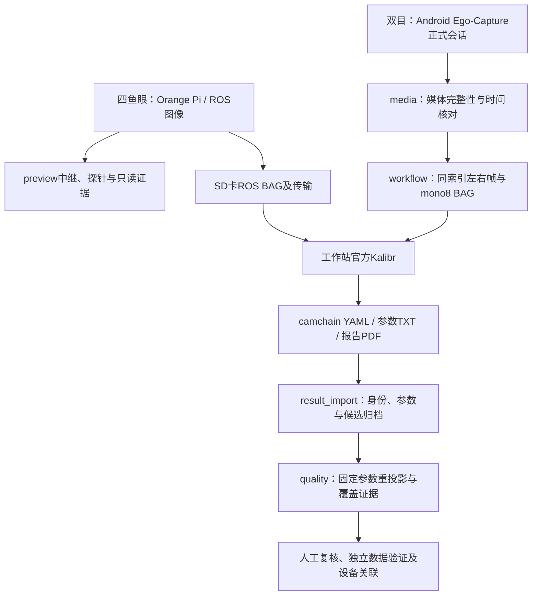

# Ego-Calib-Tools：头环采集辅助与相机标定工具

**面向Linux工作站的四鱼眼采集辅助、2UQ2双目相机标定与质量核查工具。**

[English](README.en.md) · [双目完整操作与接手说明](ego_stereo/README.zh-CN.md) · [阶段证据](ego_stereo/STATUS-20261106.md) · [采集App](https://github.com/EgoOneLabs/Ego-Capture/tree/feat/android-capture-code16)

本仓库有两条设备路线：已有Orange Pi四鱼眼预览/采集辅助，以及Android 2UQ2双目正式会话的工作站标定工具。二者输入、入口、运行端不同，不应交叉使用。官方Kalibr负责求解；本仓库负责准备数据、调用、证据归档和质量复核，不修改官方标定算法。

> **项目状态：持续开发。** 当前双目工作保存在 `feat/ego-stereo-calibration` 分支，未合入main；原四鱼眼 `preview/`、`tools/` 和日常流程保留。四鱼眼辅助工具为v1.10.4；双目已完成真实媒体/BAG通路与一份历史DS固定参数核查，独立数据和完整质量验收仍待收尾。更新日期2026-11-06；不要将脚本成功、文件齐全或角点预览当作标定验收通过。

## 功能概览与进度

| 路线 / 功能 | 已做到哪里 | 已验证与未完成 |
|---|---|---|
| 四鱼眼实时辅助 | 四路预览、中继、设备/端口操作说明 | 保留已有工具；本轮未重做头环或Docker实测 |
| 四鱼眼原生角点证据 | Kalibr探针、只读BAG证据扫描、摆板提示 | 可提供证据与操作辅助；不等于四路最终标定通过 |
| 四鱼眼部署与日常采集 | 环境检查、SD卡/ROS录制/传输及Kalibr操作文档 | 按文档核对实际服务、IP、Topic及板尺寸 |
| 双目媒体核查 | MKV/WAV完整解码与时间/来源核对 | 一条真实会话左右286帧及WAV读回通过 |
| 双目BAG准备 | 同索引抽帧、mono8、纯相机ROS1 BAG写入/全读回 | 真实smoke的36对/72条消息通过；不是板精度验证 |
| 双目官方Kalibr调用 | 模型/板配置、源码状态、日志、real/user/sys归档 | 封装已实现；新启动封装尚未在新真实板会话端到端执行 |
| 历史DS结果管理 | YAML/TXT/PDF身份、参数与双目几何核对、候选profile | 已导入匹配结果；未激活，设备唯一编号未绑定 |
| 固定参数质量核查 | 官方DS几何/AprilGrid检测；单眼/双向交叉重投影与覆盖 | 真实230/230对完成并复算；同数据一致性，不是独立验证 |
| 相机—IMU联合标定 | 不作为本双目分支已完成功能 | 重复性、IMU时间与连续性仍未验收 |
| 量产验收/设备自动绑定 | 尚未形成通用闭环 | 不支持用一份历史参数自动覆盖不同头环 |

## 系统架构



四鱼眼路线按既有文档使用Kalibr；新双目启动器只处理双目会话。相机准备/BAG/标定不是安卓App中的功能。固定参数验证只估计每帧板姿态，不重新优化内参/双目外参；文件校验不自动提升为质量通过。

| 目录 / 文档 | 接手入口 |
|---|---|
| [`preview/`](preview/) | 四路预览、中继、原生探针及BAG扫描 |
| [`tools/`](tools/) | 四鱼眼环境检查、镜像导出与报告打包 |
| [四鱼眼日常流程](docs/daily_workflow.zh-CN.txt) | 首次初始化、SD卡/ROS采集、传输和Kalibr操作 |
| [`ego_stereo/media/`](ego_stereo/media/) | 双目媒体读回；显式选择ADB设备与会话 |
| [`ego_stereo/workflow/`](ego_stereo/workflow/) | 相机图像准备、BAG写入/全读回、官方Kalibr调用 |
| [`ego_stereo/result_import/`](ego_stereo/result_import/) | 已知历史DS结果身份与profile导入 |
| [`ego_stereo/quality/`](ego_stereo/quality/) | 固定参数重投影、CSV、覆盖统计和示意图 |
| [`ego_stereo/evidence/`](ego_stereo/evidence/) | 已复核匿名数值摘要，不含原录像、BAG和现场人物图像 |

## 硬件与运行环境

| 项目 | 当前配置 / 边界 |
|---|---|
| 执行端 | Linux工作站；四鱼眼采集端另为Orange Pi；双目采集端另为Android |
| 工作站依赖 | Python3、FFmpeg/FFprobe、Docker、Git；不要求GPU |
| Kalibr容器 | 既有kalibr / ROS Noetic / `/catkin_ws`，含OpenCV、NumPy、cv_bridge、rosbag与Kalibr绑定 |
| 数据挂载 | 既有宿主数据目录绑定到容器`/data`；工具读取实际挂载并核对 |
| 双目话题 | `/cam0/image_raw`、`/cam1/image_raw`，1920×1080 mono8；BAG不含IMU |
| 四鱼眼话题 | `/fisheye/{left,right,bright,bleft}/image_raw/compressed`，按现场与日常文档核对 |
| 历史标定板 | AprilGrid 6×6，黑色tag边长0.088m，间隙0.0264m，tagSpacing=0.3；新设备/新板需核对实物 |

## 快速开始（Linux工作站）

```bash
git clone --branch feat/ego-stereo-calibration https://github.com/EgoOneLabs/Ego-Calib-Tools.git
cd Ego-Calib-Tools
```

- **接手双目**：阅读[双目完整说明](ego_stereo/README.zh-CN.md)，按“媒体核查 → BAG准备/读回 → 仅新数据标定 → 结果/质量核查”执行；已有通过的同条数据无需重跑。
- **接手四鱼眼**：阅读[日常流程](docs/daily_workflow.zh-CN.txt)和下方原部署说明。先确认ROS Master、相机服务、实际IP/Topic与挂载，不使用双目脚本代替四路录制。
- 历史发布包/镜像链接属于原四鱼眼部署来源；GitHub自动打包的源码ZIP不含Docker镜像，也不含原始数据。

## 已验证证据

| 检查 | 已有结果 | 不能据此声称 |
|---|---|---|
| 旧四鱼眼仓库检查 | [`docs/VALIDATION.txt`](docs/VALIDATION.txt)记录Python/Bash语法检查 | 该检查未运行Docker或头环，不是所有设备标定通过 |
| 双目真实媒体 | 左右286帧完整解码；48kHz双声道PCM16 WAV非全零 | 恒定30FPS、音视频/IMU硬件同步 |
| 双目真实BAG通路 | 36对/72条mono8的像素、Header、时间全读回 | 该smoke短记录已通过板覆盖或精度验收 |
| 历史DS三文件 | 模型、内参、双目变换与报告对应，基线约89.271mm | 所有设备通用或已完成设备唯一绑定 |
| 原230对固定参数验证 | 230/230共同检测；交叉RMS左0.818/右1.047px，P95左1.453/右1.678px | 独立留出数据泛化、全画幅精度或最终验收 |
| 新工具本地测试 | workflow5、结果导入5、核心几何4，共14项通过 | 再次完成真实Kalibr优化或头环实测 |

固定参数核查real/user/sys约66.381/51.352/15.042秒。逐角点CSV共100475行，已独立复算统计与覆盖。完整证据边界见[阶段记录](ego_stereo/STATUS-20261106.md)。不将“近零有符号均值”误读成误差为零。

## 未解决问题与路线图

| 优先级 | 问题 | 后续工作 / 停止条件 |
|---|---|---|
| 高 | 双目缺少独立数据验证 | 优先复用另一次已有板录制，固定参数检查一次；不是重新拟合或扫描模型 |
| 高 | 边缘覆盖不足 | 右眼最右1/8无有效角点；先查已有素材能否覆盖，不直接宣布全画幅合格 |
| 高 | 板尺度与设备唯一身份 | 核对实物板尺寸、左右顺序、头环唯一编号及候选版本，保留来源 |
| 中 | 新Kalibr启动封装端到端 | 下一次真正需要标定的新输入时验证；不为新脚本重跑已完成标定 |
| 中 | 质量验收准则 | 按实际用途约定误差、覆盖和独立数据要求；不自动给未经约定的“及格线” |
| 中 | 四鱼眼运行依赖 | 每台头环核对ROS Master/相机服务/SD卡/Topic；camd直出模式不能假定ROS话题存在 |
| 单独专项 | IMU、硬件同步与联合标定 | 保留未验收状态，与采集App协作处理，不阻塞纯相机主线 |

## 同事接手检查清单

1. 明确当前处理四鱼眼还是2UQ2双目，确认分支、输入设备、话题、板配置和容器挂载。
2. 先读对应README与阶段记录，保留输入摘要、版本、容器源码状态、日志和real/user/sys。
3. 双目`result_import`与`quality`当前锁定已知历史数据摘要，不是任意设备通用入口；不要删除摘要检查来“跑通”。
4. 不修改官方Kalibr算法，不自动替换焦距/模型、不覆盖旧结果、不把候选参数设成已验收。
5. 只对缺失证据做必要验证；新失败保留日志，先定位原因，不盲目重录或反复跑相同数据。
6. 更新已实现/已验证/未解决表，保证后续接手者能区分脚本能力、真实执行结果和正式验收。

## 许可证与贡献

本轮未新增项目授权。维护者应确认顶层许可证及第三方依赖许可；使用Kalibr、UVC/图像组件或历史镜像时遵守各自许可证，不将第三方许可自动视为整个仓库的许可。欢迎针对输入契约、设备管理、时间与质量证据提出Issue/PR。

---

## 四鱼眼工具原有部署说明

以下保留既有部署步骤与历史发布包说明，实际四鱼眼日常操作以已链接流程为准。

日常采集与 Kalibr 操作流程：[打开内置 SD 卡版终版 Word 文档](docs/头环四鱼眼相机标定采集流程_内置SD卡版_日常快速启动版本终版.docx)；另有[纯文本版](docs/daily_workflow.zh-CN.txt)。
[English](README.en.md) | [简体中文](README.md)

本工具用于四路实时预览、Kalibr原生角点证据与摆板提示。版本v1.10.4。预览不保证标定成功。以下是辅助工具的完整部署步骤，不自动运行相机、IMU或联合标定。

## 文件放在哪里

| 位置 | 内容与用途 |
|---|---|
| [README.en.md](README.en.md) / [README.md](README.md) | 英文／中文部署说明。新电脑先读中文 README，按步骤准备 Docker、导入镜像并启动预览。 |
| [日常采集流程 Word](docs/头环四鱼眼相机标定采集流程_内置SD卡版_日常快速启动版本终版.docx) / [纯文本版](docs/daily_workflow.zh-CN.txt) | 标定员的实际操作：新头环首次设置、SD 卡录制、传输 BAG 和 Kalibr 验证。头环 IP 与 BAG 名只是示例，换设备时按现场修改。 |
| [docs/](docs/) | 快速启动、验证说明及日常流程。 |
| [preview/](preview/) | 四路预览启动脚本、Python 中继与角点探针、网页界面及标定板配置。`output/` 在运行时生成。 |
| [tools/](tools/) | 环境检查、Docker 镜像导出、预览报告打包脚本。 |
| [v1.10.4 Release](https://github.com/BAAI-Ego/headband-calibration-tools/releases/tag/v1.10.4) | 带 Docker 镜像的完整部署包和 SHA256 校验文件，须从 Releases 单独下载。 |

在仓库顶部的 **Code** 页点击文件夹查看源码和文档；在页面右侧的 **Releases** 下载完整包。日常流程文档讲采集与 Kalibr 操作，本 README 讲新电脑部署与辅助预览工具。

## 开始前：需要获取什么

| 要获取的东西 | 从哪里获取 | 用途 |
|---|---|---|
| `EgoOneLabs/Ego-Calib-Tools` 的当前开发分支 | 本页的 **Code** 或下文克隆命令 | 最新中英文说明、`docs/` 日常流程、`preview/` 工具源码、`tools/` 检查脚本 |
| 完整包 `.tar` 和对应的 `.tar.sha256` | [v1.10.4 Release 的 Assets](https://github.com/BAAI-Ego/headband-calibration-tools/releases/tag/v1.10.4) | 获取约 1.5 GiB 的 Kalibr Docker 镜像并校验下载完整性 |

两处内容都需要获取。GitHub 自动生成的 **Source code ZIP 不含 Docker 镜像**。若仓库或历史发布包要求授权，账号须具备对应读取权限。以下按新工作站首次部署的顺序写，命令均在 **Linux 工作站** 执行，除非特别标注“头环终端”。每条注释说明紧跟的命令；按小节执行，遇到失败先停下处理。

## 第一步：准备工作站

适用 Ubuntu/Debian、x86_64。工作站应有可用网络，下载、解压和 Docker 镜像层建议预留至少 20 GB。头环应已具备原相机驱动和 ROS 环境。

```bash
# 工作站：确认是 x86_64（镜像仅适用于 linux/amd64）。
uname -m
# 工作站：查看下载目录和 Docker 存储空间；建议预留至少 20 GB。
df -h "$HOME" /var/lib
# 工作站：刷新系统软件包索引。
sudo apt-get update
# 工作站：安装 Git、GitHub CLI、SSH 和网络检查工具。
sudo apt-get install -y git gh openssh-client python3 unzip rsync arp-scan netcat-openbsd
```

## 第二步：克隆当前开发分支（包含原四鱼眼工具）

首次在私有仓库使用 `gh` 时先登录。已有克隆目录时，先检查本地修改，勿覆盖。

```bash
# 工作站：查看 GitHub 登录状态；如未登录，运行下一条交互命令。
gh auth status
```

如果显示未登录，再执行：

```bash
# 工作站：在浏览器完成 GitHub 授权。
gh auth login
```

然后继续：

```bash
# 工作站：进入个人目录；下面的 clone 会创建新目录，已有目录时请先核对。
cd "$HOME"
# 工作站：克隆独立工具仓库的 main 分支。
gh repo clone EgoOneLabs/Ego-Calib-Tools -- --branch feat/ego-stereo-calibration
# 工作站：进入源码目录；后续工具命令从这里执行。
cd "$HOME/Ego-Calib-Tools"
# 工作站：确认当前分支为 main。
git branch --show-current
# 工作站：确认两份 README 都在仓库根目录。
ls -l README.en.md README.md
```

已有 `~/Ego-Calib-Tools` 时不要重复克隆；进入目录运行 `git status`，确认无本地修改后使用 `git pull --ff-only` 更新。

## 第三步：下载并校验镜像附件

Release 页面下载的是完整包与校验文件，共两个附件；源码已在第二步克隆。以下命令也可代替在网页手动点击 Assets。

```bash
# 工作站：创建专门的下载目录。
mkdir -p "$HOME/Downloads/headband-v1.10.4"
# 工作站：下载完整部署包和 SHA256 文件；如网络中断，检查目录后重试。
gh release download v1.10.4 --repo BAAI-Ego/headband-calibration-tools --dir "$HOME/Downloads/headband-v1.10.4" --pattern 'headband-calibration-assistant-v1.10.4-full.tar*'
# 工作站：进入附件目录，两份附件必须同时存在。
cd "$HOME/Downloads/headband-v1.10.4"
# 工作站：核对下载的文件名与大小。
ls -lh headband-calibration-assistant-v1.10.4-full.tar*
# 工作站：校验完整包；失败时停止，不要解压或导入。
sha256sum -c headband-calibration-assistant-v1.10.4-full.tar.sha256
# 工作站：解压到当前目录；已有同名解压目录时先停止并核对。
tar -xf headband-calibration-assistant-v1.10.4-full.tar
# 工作站：进入解压目录，校验内部文件（包含环境镜像）。
cd headband-calibration-assistant-v1.10.4-full
sha256sum -c SHA256SUMS
```

Release 附件名为 `headband-calibration-assistant-v1.10.4-full.tar` 和 `headband-calibration-assistant-v1.10.4-full.tar.sha256`。该归档是发布时快照，内含旧版 README 文件名；**后续操作以刚克隆的 `main` 上的 README 和日常流程文档为准**。归档主要用于导入 `environment/kalibr-environment.tar.gz`。

## 第四步：安装 Docker 并导入 Kalibr 镜像

若系统已有 Docker，保留现有安装。若 `docker info` 报权限错误，应由管理员配置当前用户权限并重新登录，再继续。若已有名为 `kalibr:noetic` 的不同镜像，先核对用途，避免导入时改写旧标签。

```bash
# 工作站：仅在 Docker 命令不存在时安装 docker.io 并启动服务；不要与已有 Docker CE 混装。
if ! command -v docker >/dev/null; then sudo apt-get install -y docker.io; sudo systemctl start docker; fi
# 工作站：确认当前用户可以直接调用 Docker；失败时先解决权限。
docker info
# 工作站：检查现有 kalibr:noetic 镜像；不存在时会报错，可继续；若 ID 不同须先核对，不能直接覆盖标签。
docker image inspect kalibr:noetic --format '{{.Id}} {{.Os}}/{{.Architecture}}'
# 工作站：查看附件镜像记录的 ID 与平台。
cat environment/image-id-platform.txt
# 工作站：再次核验镜像压缩包。
(cd environment && sha256sum -c SHA256SUMS)
# 工作站：确认同名标签不存在或经管理员确认可导入后，导入镜像。
docker load -i environment/kalibr-environment.tar.gz
# 工作站：检查导入后的镜像 ID 与平台。
docker image inspect kalibr:noetic --format '{{.Id}} {{.Os}}/{{.Architecture}}'
# 工作站：返回当前 main 的源码目录。
cd "$HOME/Ego-Calib-Tools"
# 工作站：运行不连接头环的本地依赖检查。
bash tools/check_preview_environment.sh
```

导入镜像后应看到 ID `sha256:ddbe45d2bd03e8a415688355dc23c4ceedf6eb576e1c6d7eeafa51567fa10b29`、`linux/amd64`，依赖检查应出现 `DEPENDENCIES_PASS`。docker 组有较高系统权限，应由管理员决定是否使用。宿主机无需另装 ROS，也不要通过 pip 替换镜像内编译好的 Kalibr 依赖。

接下来按第五步检查头环和四路 Topic，再按第六步先运行 60 秒预览。启动预览会通过 SSH 在头环临时运行中继并增加负载，不自动运行原 BAG 录制。

## 第五步：找到并检查头环

工作站执行，eno1与网段按现场实际值修改；一次只连接一台头环：

```bash
sudo arp-scan --interface=eno1 192.168.10.0/24
# 修改实际头环IP；确认设备SSH指纹
ssh orangepi@192.168.10.109
```

出现REMOTE HOST IDENTIFICATION HAS CHANGED时，先在头环本地核对指纹，确认后才删除旧记录：

```bash
# 头环本地终端
sudo ssh-keygen -lf /etc/ssh/ssh_host_ed25519_key.pub
# 工作站终端，核验后执行，IP按实际修改
ssh-keygen -f "$HOME/.ssh/known_hosts" -R 192.168.10.109
```

22端口拒绝连接时，需固件维护者做首次本地SSH/相机服务设置，不是预览软件故障。原流程中的enable/restart服务、SD卡写测试属于明确的一次性操作；不混入只读检查。

SSH进入头环后：

```bash
# 头环终端，只检查现有环境
source /opt/ros/noetic/setup.bash
export ROS_MASTER_URI=http://localhost:11311
python3 -c 'import rospy,cv2,numpy; from sensor_msgs.msg import CompressedImage; print("HEADBAND_DEPENDENCIES_PASS")'
systemctl is-active seeker_cam_bridge.service
for TOPIC in /fisheye/left/image_raw/compressed /fisheye/right/image_raw/compressed /fisheye/bright/image_raw/compressed /fisheye/bleft/image_raw/compressed; do
  if timeout 8 rostopic echo -n 1 "$TOPIC" >/dev/null; then
    echo "PASS $TOPIC"
  else
    echo "FAIL $TOPIC"
  fi
done
exit
```

检查会短时订阅图像并增加负载。四路应PASS。头环IP不能固定写死；SSH通不代表ROS双向网络可达。不要为了预览关闭防火墙或更改相机分辨率。

## 第六步：核对板配置并启动预览

preview/config/april_6x6.yaml参考值为6×6、tagSize=0.088m、tagSpacing=0.3。实测黑边长a、白缝b应对应tagSize=a、tagSpacing=b/a。确认本次板后配置，不覆盖历史YAML。

工作站、本包根目录执行；两个IP按实际修改：

```bash
cd preview
# 头环IP 工作站有线IP 档位 自动结束秒数
bash run_temporary_four_preview.sh 192.168.10.109 192.168.10.10 balanced 60
```

浏览器打开http://127.0.0.1:8766。默认单行BRIGHT、RIGHT、LEFT、BLEFT。balanced宽640、目标5FPS，不是录制频率。首次先做60秒验收；正式人工结束模式省略第四参数：

```bash
bash run_temporary_four_preview.sh 192.168.10.109 192.168.10.10 balanced
```

启动会通过SSH在头环临时运行中继，订阅原图、缩放压缩，增加负载，不写持久程序或改驱动。不要同时启动多个实例。未观察到144/144只能表示低清证据不足。

## 第七步：结束、保存报告与正式录制

人工模式在预览终端Ctrl+C，等待退出。确认JSON报告已保存后：

```bash
# 当前仍在preview目录
bash ../tools/package_preview_report.sh
```

报告在preview/output。网络中断时清理可能不完整，应核对本次中继，不能默认退出即远端清理成功。文件权限问题应检查输出目录所有权，不对整个工程chmod 777。

原rosbag录制独立执行。头环先确认SD卡挂载/空间：

```bash
# 头环终端
findmnt -no SOURCE,TARGET,FSTYPE /media/orangepi/sdcard
df -h /media/orangepi/sdcard
```

每次新BAG名，正常Ctrl+C一次并等回提示符，再rosbag info、sync、传输、双端SHA256。原命令在docs/头环四鱼眼相机标定采集流程_内置SD卡版_日常快速启动版本终版.docx；不改变原录制。对副本做恢复，.orig.bag通常是未索引备份。reindex成功不代表完整：还需核对时长、四路CompressedImage类型及解码。5.2秒恢复文件、Topic不匹配与DLT点数不足不能当作硬件故障结论。

正式Kalibr仍用独立副本，检查误差和内外参。DS输出在独立测试目录，第三步必须明确指定真实camchain，不能认为自动出现在camera目录。Camera与Camera-IMU分开；第三步模板5Hz、--cams，另需动态Camera-IMU BAG与imu.yaml，本部署包不提供。

## 第八步：常见问题

| 现象 | 处理 |
|---|---|
| 文件不存在 | 先确认文件已下载、真实文件名/路径；聊天链接不是工作站路径。 |
| 终端一直显示 > | 引号或heredoc没结束，Ctrl+C取消；用脚本文件，避免长段粘贴。 |
| NameError 本地依赖导入通过 | 旧检查脚本引号错误，现版使用Python heredoc；不靠安装软件修复。 |
| GDK连接失败/rosdep view empty | 检查是否有后续Traceback及退出码；警告本身不证明通过，不为消警告盲目rosdep init或启动GUI。 |
| aslam_cv等导入失败 | 核对镜像ID、setup.bash，停止并核实环境，不pip替换绑定。 |
| 缺少kalibr:noetic | 导入Release中的实际镜像；不等于需要启动原kalibr容器。 |
| docker权限不足 | 按第四步由管理员配置，重新登录。 |
| SSH通但无视频 | 查实际IP、ROS双向可达、Topic和服务；不是只检查22端口。 |
| 8766占用 | ss -ltnp检查，只停止确认属于旧预览的进程。 |
| 校验值不一致 | 停止导入，重新下载对应附件。 |
| 上传GitHub中断 | 不重复提交源码；先查看main与Release Assets，按缺失附件续传。 |

## 第九步：发布状态与验收

原工作站镜像导出及SHA256已通过；Python/Shell语法检查完成。未做新工作站完整验收，不承诺下载后必然标定成功。另一工作站应记录平台、镜像ID、日期、四路视频连续性、探针完成/异常、报告保存、正常退出清理、并行录制及独立Kalibr质量检查。

离线扫描原脚本含历史路径及20Hz取样，不等同当前10Hz标定，迁移前核对。工具许可证由权利人确认，第三方许可保留。
