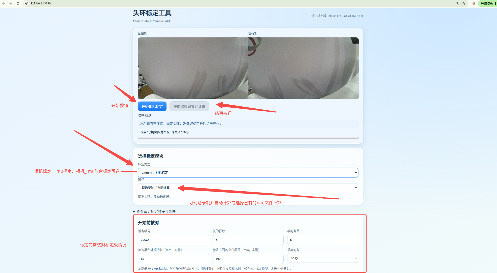
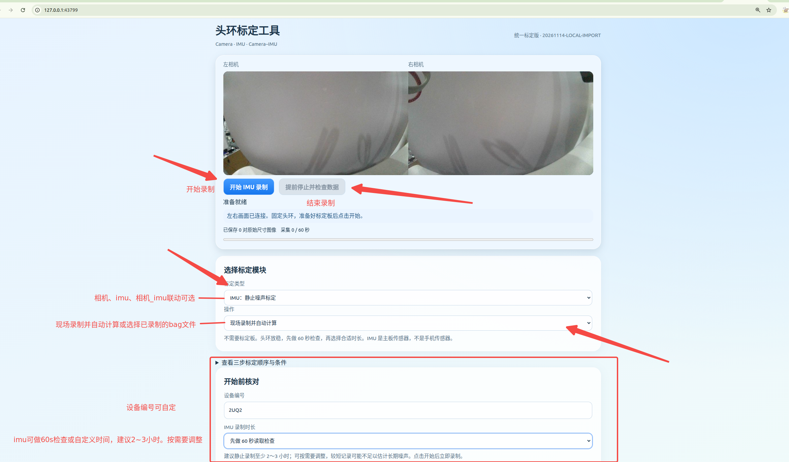
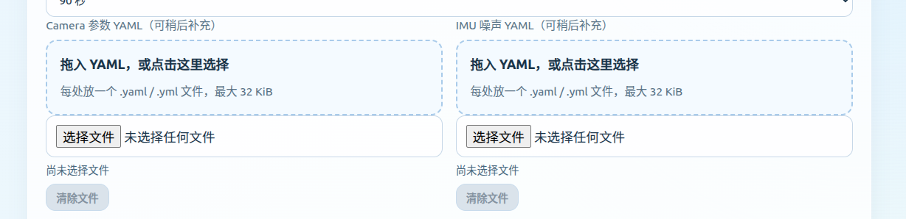
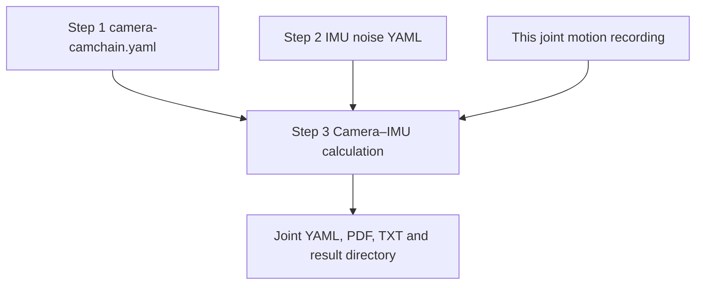

# Camera & IMU Calibration App README

[简体中文](README.zh-CN.md) · [Project overview](../../../README.md) · [Phone capture](../capture/README.md)

One Linux app handles **Camera**, **stationary IMU analysis** and **Camera–IMU calibration**. Connect the headband directly to Linux, not through the phone app. The current pre-release is `20261115-PROCESS-WAIT`, with English as the default and a Chinese switch. It has passed all three existing-data calculation workflows on the reference workstation; the complete installer is available as a public pre-release.

The immediate goal is to demonstrate recording, calculation and result-file generation. Optional joint-result review stays collapsed. It is not a prerequisite for normal use.

## Choose your first route

| Your starting point | Follow these sections | Prepare first |
|---|---|---|
| New Ubuntu installation | Sections 1–3, then Camera in section 5 | Complete installer, data cable and measured target |
| Tool already installed; record new data | Section 4, then the appropriate module in sections 5–7 | Headband; Camera and joint recording also need a target |
| Recording already exists | Section 8, then calculate the selected module | Camera BAG; paired IMU CSV+JSON; or joint data plus two parameter YAMLs |
| Camera and IMU results already exist | Section 7 | camera-camchain.yaml and applicable IMU-noise YAML |

For each module, follow “configure → start → perform the motion or stay still → stop → wait for calculation → locate results”. Finish one job before switching modules. Record the **result directory shown by the app** after each calculation.

### Read the supplied screenshots

The app initially uses English. The real Camera/IMU screenshots supplied with the handover show the earlier LOCAL-IMPORT interface in Chinese. They identify control locations; input requirements and behavior in this guide were checked against current PROCESS-WAIT source. Current joint recording can start before parameter import. Tap an image to open it at full size and zoom in on the arrows.

| Chinese screenshot label | Current English control | Location |
|---|---|---|
| 标定类型 | `Calibration type` | Module selection |
| 操作 | `Operation` | Recording or existing-data selection |
| 已有录制，直接计算 | `Calculate from an existing recording` | Operation dropdown |
| 选择本地文件 | `Browse local files` | Recording import area |
| 选择录制文件夹 | `Browse recording folders` | Recording import area |
| 开始计算 | `Start calculation` | Main control beside the preview |
| 打开结果文件夹 | `Open result folder` | Results area |

## 1. Prepare

Use Ubuntu 22.04/24.04 desktop on x86_64, network access and sudo. Previous new-machine calculation evidence is from Ubuntu 22.04; 24.04 lacks equivalent complete hardware coverage. Allow at least 30 GiB initially, plus the recording/import space shown in the app. Disable sleep for long recordings.

Secure both cameras and the mainboard. Close other apps that own the device. Prepare a flat target for Camera and Camera–IMU; stationary IMU needs no target. Follow [Hardware Setup](../hardware/README.md) and [Target Printing](../calibration-targets/README.md). Measure your printed target: the A4 example is 25 mm / 7.5 mm; the full-size example is 88 mm / 26.4 mm.

## 2. Download, install and update

### From the release page to the first launch

Perform this download and the commands below on the **Ubuntu calibration computer**.

1. Open the [current complete Linux release](https://github.com/EgoOneLabs/Ego-Calib-Tools/releases/tag/camera-easy-v1.9-bilingual), scroll to **Assets**, and expand it.
2. Download **camera.zip** and **camera.zip.sha256**. The complete ZIP is about 1.8 GB. Wait until both downloads finish; temporary browser download extensions indicate an unfinished download.
3. Put the two files in one new folder, for example `headband-install`. If a browser added a suffix such as `(1)`, isolate this pair in the new folder and restore the matching filenames.
4. Right-click empty space in that folder and choose Open in Terminal. The following commands use the terminal's current directory:

```bash
ls -lh camera.zip camera.zip.sha256
sha256sum -c camera.zip.sha256
```

5. When the checksum reports `camera.zip: OK`, run each command below, continuing only when the previous command succeeds:

```bash
sudo apt-get update
sudo apt-get install -y unzip
unzip camera.zip
bash camera.run --check
bash camera.run
```

6. Sudo requests this Ubuntu computer's login password. Password characters are invisible while typing; press Enter afterwards. Run camera.run as your normal user.
7. The installer configures system dependencies, USB access and the Kalibr environment. Keep internet access and the terminal available until the local browser page opens. If installation exits with an error, retain the exact message and use section 10.
8. Reconnect the headband if USB permissions have not taken effect. If a group update requires a new login, log out of Ubuntu, log in, and launch the tool from the application menu.

**Checkpoint**: the page opens, the version is PROCESS-WAIT, and both previews update continuously. The browser uses this computer's 127.0.0.1 address and an automatically selected port. Future launches use section 3; installation is a one-time setup unless you update the software.

For an update, finish current recording/calculation and exit the old launcher with Ctrl+C first. Existing data is retained; actual paths may follow a reused container mount.

<details><summary>Advanced: lightweight update with an existing environment</summary>

Download [install-calibration.sh](https://github.com/EgoOneLabs/Ego-Capture/blob/feat/english-default-code20/docs/downloads/install-calibration.sh), [headband-calibration.zip](https://github.com/EgoOneLabs/Ego-Capture/blob/feat/english-default-code20/docs/downloads/headband-calibration.zip) and its [checksum](https://github.com/EgoOneLabs/Ego-Capture/blob/feat/english-default-code20/docs/downloads/headband-calibration.zip.sha256) into one directory, then run `bash install-calibration.sh` there. This small package does not contain the image. On a new machine, it downloads verified historical environment parts and extracts only the image, without executing the old app. The checked-in snapshot contains PROCESS-WAIT, including bilingual UI and correct waiting for calculation subprocesses. Developers should use the [Development Guide](../guides/DEVELOPMENT.md).

</details>

## 3. Open, change language and exit

Search for **Headband Calibration Tool** in the application menu after installing the bilingual update. Older installations use **头环标定工具**. The stable launcher command is:

```bash
gio launch "$HOME/.local/share/applications/ego-camera-calibration.desktop"
```

Keep the launcher terminal open. The browser uses a local `127.0.0.1` address with a port that may change; do not bookmark an old port. Closing the browser does not delete data and may leave the task running. Exit with Ctrl+C in the launcher terminal.

The proposed bilingual page defaults to English, with a **中文 / English** switch. Switching must not reload the page or interrupt recording. Browser language preference is local to the page origin; a new launch port may start in English again. Original backend/third-party diagnostic logs are preserved and may be in Chinese. File names, user input, parameters and recorded data are never translated.

## 4. Choose your workflow

| Workflow | Action |
|---|---|
| Record now | Connect USB, enter settings, start beside the live preview, then finish or wait for automatic stop |
| Existing recording | Drop files/folders or browse locally; after import, start calculation |

Controls, progress and instructions sit beside the preview. During computation, the live log shows actual process output. A quiet log alone does not prove a stall. At completion, the page displays file links, the actual directory and **Open result folder**.

Recommended order: Camera → IMU → Camera–IMU. Camera and IMU can be done in either order. Joint motion may be recorded first; calculation is the point at which the two parameter files are required.

## 5. Camera: record and calculate



### Fill the Camera form using the annotated image

Find the arrows pointing to Calibration type and Operation, then the outlined Before you start fields. Configure them before using the start button beneath the preview.

| Field | First-run choice | What to check |
|---|---|---|
| Calibration type | Camera | Instruction says to keep the headband fixed and move the target |
| Operation | Record and calculate automatically | The main control starts recording |
| Device ID | This headband's actual ID | Keep it consistent in later modules |
| Target rows and columns | 6 and 6 for the supplied targets | Count six tags in each row and column |
| Measured black tag edge | Measured millimetres | Nominally 88 for the full-size target, 25 for A4 |
| Measured white gap | Measured millimetres | Nominally 26.4 for the full-size target, 7.5 for A4 |
| Recording duration | 60 seconds for the first attempt | Calculation continues after recording ends |

**Example 60-second motion**: keep a clear central view for about 10 seconds, move slowly toward edges/corners for about 20 seconds, change distance and tilt for about 20 seconds, then return to a steady view. This is a practical example; adjust it to keep tags sharp and visible in both cameras.

During recording, check that image-pair counts and elapsed time increase. After recording stops, wait for BAG preparation and the solver. Keep the launcher and browser open while the live log runs. Continue when result-file links and the actual result directory appear.

**Keep the input for step 3**: click camera-camchain.yaml to download a copy, or Open result folder to locate the original. Keep it with its reports. The Camera parameter box in step 3 needs this YAML. A BAG without the result YAML requires troubleshooting of that calculation.

**Keep the headband fixed and move the target.** No IMU parameters are required.

1. Select **Camera: stereo calibration** and the recording workflow.
2. Enter the device ID, target rows/columns, measured black tag edge and white gap in **millimetres**.
3. Choose 60, 90 or 120 seconds. Confirm both cameras can see a clear target.
4. Start. Move the target slowly through the centre, edges and corners, varying distance, tilt and in-plane rotation.
5. Keep it visible to both cameras where possible. Avoid glare, bending and fast blurred motion. Not every image needs the entire board.
6. Wait for automatic stop or finish early after enough images. The 40-pair early-stop threshold is a program condition, not a quality threshold.
7. Wait for BAG preparation, readback checks and Kalibr DS stereo calculation. Open the results.

| Output | Purpose |
|---|---|
| `camera.bag` | Camera input data |
| `camera-camchain.yaml` | Camera intrinsics and stereo extrinsics; the **Camera input for step 3** |
| `camera-report-cam.pdf` | Calibration report |
| `camera-results-cam.txt` | Parameter/error summary |
| `aprilgrid.yaml` | Target geometry used for this run |
| Verification JSON, calculation JSON and logs | Input checks, status and timing |

Preview is color; saved calibration images may be full-resolution grayscale. No manual focal-length entry is required. An imported camera BAG uses its accompanying target configuration, or the measured values in the current form if none was supplied.

## 6. IMU: stationary recording and noise analysis



### Choose the IMU duration and inspect the result

The IMU image shows the start/stop controls beneath the preview. Select IMU first; target-size fields are hidden and IMU duration controls appear.

| Goal | Choice | Inspect afterwards |
|---|---|---|
| First readout test | 60-second readout check | Sample, error, gap and duplicate counts, followed by analysis or a specific error |
| Test analysis using existing successful data | Calculate from an existing recording, then section 8 | Allan CSV, analysis JSON, PDF and TXT |
| Observe longer-term noise | 2 hours, 3 hours or a custom duration | Per-axis fits and candidate-YAML availability |

After starting, keep the assembly and cable still. Recording is followed by analysis. Scroll to Processing results and the file links when analysis finishes. IMU_ANALYSIS_NEEDS_REVIEW requires reading the per-axis messages: curves and reports can exist while a complete noise YAML remains unavailable.

**Checkpoint**: back up imu_samples.csv with imu_capture.json, and retain the reports. Use an applicable generated imu-candidate.yaml or deliberately selected experimental-weight YAML in the right-hand box of step 3. Repeating a software-path check with existing data does not require another two-hour acquisition.

**Keep the complete headband stationary.** No target or Camera parameters are required. Data comes from the headband IMU.

1. Select **IMU: stationary noise analysis** and enter the device ID.
2. Put it on a stable surface with cable slack. Exact leveling is not required.
3. Start with the 60-second readout check. Inspect samples, errors, duplicates and gaps.
4. For long-term noise analysis, aim for at least **2–3 hours**. This is a recommendation, not an official Kalibr minimum or a hard software gate. Custom duration supports **1 minute to 24 hours**.
5. Start recording. There is **no warm-up countdown or discarded warm-up interval**. Do not touch the device, table or cable. Maintain power and disable sleep.
6. Wait for automatic analysis or stop early. Analysis uses continuous segments; it does not zero-fill gaps or concatenate away real elapsed time.
7. Review the Allan curves, per-axis results and output path.

| Output | Purpose |
|---|---|
| `imu_samples.csv` + `imu_capture.json` | Paired input for reanalysis |
| `imu_packets.bin`, `imu_requests.csv` | Raw packets and readout diagnostics |
| `imu-allan.csv`, `imu-report.pdf` | Allan data and report |
| `imu-analysis.json`, `imu-results.txt` | Analysis status and per-axis results |
| `imu-candidate.yaml` | Generated only when the current fitting conditions are met |
| `imu-experimental.yaml` | Explicitly generated experimental weights; not formal noise acceptance |

A term marked **Not identified** does not establish a faulty sensor. Retain the data and curves. Stationary noise analysis is not a complete scale-factor, axis, bias or temperature calibration.

### If step 3 needs an IMU YAML

- If `imu-candidate.yaml` exists, use it and review its report.
- To test the joint workflow with explicitly accepted experimental weights, after **live IMU analysis** click **Generate experimental mixed-model weights** beneath the per-axis table. Retain both `imu-experimental.yaml` and `imu-experimental-fit.json`.
- If fitting rejects the available time range or fails, there are no usable weights from that attempt. Do not rename reports to YAML, fill missing values with zeros or borrow another device's parameters.

The existing-data analysis page currently lacks the same generation button. The optional command below calls the installed fitting module without recording again.

<details><summary>Experimental fallback for an existing IMU analysis result</summary>

Copy the real result path from **Open result folder**. It must contain `imu-allan.csv` and `imu-analysis.json`. Reuse an existing experimental YAML rather than regenerating it.

```bash
# Linux computer. CHANGE ONLY RUN to the actual IMU analysis directory.
(
  set -euo pipefail
  RUN="/actual/path/to/IMU-analysis"
  /usr/bin/python3 - "$RUN" <<'PYCODE'
from pathlib import Path
import shlex
import subprocess
import sys

run = Path(sys.argv[1]).expanduser().resolve()
for name in ('imu-allan.csv', 'imu-analysis.json'):
    if not (run / name).is_file():
        raise SystemExit(f'Missing required analysis file: {run / name}')
entry = Path.home() / '.local/share/applications/ego-camera-calibration.desktop'
command = next(line[5:] for line in entry.read_text().splitlines()
               if line.startswith('Exec='))
root = Path(shlex.split(command)[1]).parent
module = root / 'imu_experimental.py'
if not module.is_file():
    raise SystemExit(f'Installed fitting module not found: {module}')
subprocess.run(['/usr/bin/python3', str(module), str(run)], check=True)
print('Generated:', run / 'imu-experimental.yaml')
PYCODE
  xdg-open "$RUN"
)
```

Insufficient data or an unsuccessful fit can still cause rejection. This is an experimental workflow, not a way to bypass noise-observation requirements.

</details>

## 7. Camera–IMU: record and calculate

### Match the files to step 3



Parameter-box location reference from an earlier actual interface: Camera YAML on the left, IMU noise YAML on the right. Confirm the selected filenames beneath both boxes in the current version.



1. Open the Camera result folder and locate camera-camchain.yaml. Keep the PDF/TXT for reading; the parameter box needs the YAML.
2. Open the IMU result folder and locate the applicable imu-candidate.yaml, or imu-experimental.yaml if experimental weights were deliberately selected. If neither exists, follow section 6 first.
3. Select Step 3 — Camera–IMU. In the two-parameter area, drop the Camera YAML into the **left Camera box** and the IMU YAML into the **right IMU-noise box**.
4. Alternatively, click each box, browse to the result directory and select its file. Supply one YAML per box, at most 32 KiB each.
5. Read the filenames displayed beneath both boxes and check the device/assembly. Check automatically restored files too. Use Clear file to replace an incorrect selection.
6. For **live recording**, these files may be supplied later. For **calculation from existing data**, select the joint recording and both files before starting. Record the original-data path if recording finishes with parameters missing; section 8 explains how to continue that recording without repeating motion.

### Example 90-second motion

These timings help organize an attempt; they are not acceptance thresholds. Keep the target fixed and move the complete assembly.

| Approximate period | Motion | Watch for |
|---|---|---|
| First 5 seconds | Hold the frame steady | Both cameras can see the target |
| Next 20 seconds | Turn left/right several times | Keep the target within view |
| Next 20 seconds | Nod up/down several times | Keep tags sharp |
| Next 20 seconds | Roll left/right, then combine rotations smoothly | Cameras/mainboard move together; cable stays slack |
| Remaining time | Add small forward/back and lateral translations, then pause | Avoid impacts and supporting a loose board separately |

With both parameters ready, use Start recording and calculate and wait for the solver after recording. With parameters missing, use Start joint recording and retain the data. Successful existing-data calculation displays joint-camchain-imucam.yaml, joint PDF/TXT files and the result directory. Prefixes may differ for older recording paths; use the actual links shown.

**Keep the target fixed and move the entire rigid headband.** This estimates the camera–IMU relationship and time offset, using:

| Required for calculation | Where it comes from |
|---|---|
| Joint motion recording / BAG | This step's recording or an imported complete joint dataset |
| `camera-camchain.yaml` | Camera calculation in step 1; includes camera intrinsics/stereo geometry |
| `imu-candidate.yaml` or explicitly accepted `imu-experimental.yaml` | IMU analysis in step 2 |
| Target geometry | Measured form values or the recording's target configuration |

Drop the two **YAML parameter files** into the named boxes. PDF and TXT reports are not substitutes. Files must match the same device and fixed assembly. Parameters explicitly generated or selected for that device may be restored; check their names and provenance.

1. Select **Step 3 — Camera–IMU calibration**, the recording workflow, device ID, measured target geometry and duration.
2. Both files present: **Record and calculate** starts automatic calculation after capture. Files missing: **Start joint recording** still records and saves data.
3. Begin briefly at rest, then smoothly rotate about all three axes: yaw, pitch and roll. Add combined rotations and some translation with changing speed.
4. Keep the target visible in both cameras. Avoid shocks, violent shaking and blur.
5. Finish or wait for automatic stop. If parameters were missing, choose the existing-recording workflow, select this saved recording, add both YAML files and calculate. There is no need to record again just to add parameters.
6. Follow the live log, then save the result files and displayed paths.

Outputs normally include `joint-camchain-imucam.yaml`, `joint-report-imucam.pdf`, `joint-results-imucam.txt`, status/log files and a review archive. Older versions may use a `camera_imu-` prefix. Raw recording and calculation results can be in different directories; the page shows the actual locations.

## 8. Import existing recordings

### Browse local files step by step

1. Select Camera, IMU or Camera–IMU, then choose Calculate from an existing recording. The recording-selection area appears.
2. Open the computer's file manager at the **single recording** you want. Drag the required files into the large dashed box, or click Browse local files.
3. For Camera, select one BAG. Hold Ctrl to also select aprilgrid.yaml if present. For IMU, hold Ctrl and select **both** imu_samples.csv and imu_capture.json, then click Open.
4. To import a complete recording folder, click Browse recording folders, select that one recording and confirm the browser's folder-access prompt. Avoid a parent folder containing multiple devices or recording sessions.
5. Wait for import to finish. Check the selected path and status. Keep the page and launcher open during large copies. If a required file is missing, supply it and select the input again.
6. Check target dimensions for Camera, stationary input for IMU, or both YAMLs for joint calculation. Click Start calculation beside the preview. If disabled, hover over it and follow its explanation.
7. Follow the live log below. When complete, click Open result folder. Recalculation creates a separate result directory and retains the source. A newly imported recording is selected automatically.

**Checkpoint**: one recording is selected, and calculation ends with the relevant files and a result path. Camera BAGs, IMU CSV/JSON pairs and joint BAGs have different requirements, listed below.

| Module | Drop or select |
|---|---|
| Camera | One ROS1 camera `.bag`, optionally `aprilgrid.yaml`, or a single recording folder containing them |
| IMU | Both `imu_samples.csv` and `imu_capture.json`, or the complete stationary-recording folder; arbitrary IMU BAGs are not supported |
| Camera–IMU | A joint BAG or complete raw folder with images, manifests, CSV, clocks and metadata; also supply the two parameter YAML files |

Use drag-and-drop, **Browse local files** or **Browse recording folders**. Successful import selects the dataset automatically. The discovered-local-recordings list is an optional shortcut. Files are copied in chunks into local `imports/`; nothing is uploaded to the internet and originals are retained. Keep the page and terminal open. Import supports at most 20,000 files and 100 GiB per request; reserve space for copies and computation.

BAG topics are `/cam0/image_raw` and `/cam1/image_raw` (`sensor_msgs/Image`), plus `/imu0` (`sensor_msgs/Imu`, SI units) for joint input. The app checks structure and timing; it does not guess units, rename topics or repair backward timestamps automatically.

## 9. Results and optional review

### Locate the files after calculation

Recording completion and calculation completion have separate outputs. Recording saves source data; calculation must also finish the module's parameter estimation or analysis. When the calculation ends:

1. Copy the full displayed result directory. Existing workstation mounts and new-install defaults can differ.
2. Click Open result folder. It opens the job directory in the computer's file manager. Clicking a blue filename downloads a copy through the browser, which can save it in a different folder.
3. Keep Camera YAML/PDF/TXT; paired IMU source files, Allan/analysis reports and any generated parameters; or joint YAML/PDF/TXT and both input YAMLs.
4. Archive the device ID, target dimensions and result path with the files. Record functional workflow completion separately from longer-term noise or accuracy conclusions.

If only a job status or log exists, or a YAML is reported missing, expand error details and the live log to identify the cause. A progress bar at 100% or a screenshot alone does not establish successful calculation.

A workflow run is complete when calculation exits successfully and the expected files and paths appear. A saved recording without its result YAML is not a completed joint calculation. File generation does not establish final accuracy or hardware synchronization.

Keep the device ID, assembly state, versions, measured target dimensions, parameter provenance, reports and logs. New installations normally use `~/EgoStereoIMU/calibration_data/`; existing systems may reuse another Docker `/data` mount. **Use the actual path displayed in the app.**

Optional joint-result review is collapsed at the bottom of step 3. It holds joint extrinsics/time offsets fixed while fitting trajectory, gravity and IMU biases on another independent motion recording. It is neither recalibration nor fully open-loop validation, and is not required for normal recording/calculation.

## 10. Troubleshooting

| Symptom | First action |
|---|---|
| Joint record button disabled | Confirm RECORD-FIX or later. Live recording does not require YAMLs; existing-data calculation does require data and both YAMLs |
| Cannot finish early | Wait for at least 40 image pairs or the automatic end time |
| Missing imported files | Select the module's complete input set; a joint folder needs more than CSV and IMU input needs more than reports |
| Missing output YAML | Find the first real error in the calculation log; do not assume target dimensions caused it |
| No preview | Check cable, USB access and competing programs; reconnect without starting duplicate instances |
| Insufficient disk space | Back up before cleaning or changing disks; do not remove active inputs |
| Git / rosdep error | Use the current installer and retain the log; do not repeatedly reinstall everything |

See [Data Formats](../guides/DATA_FORMAT.md) and [Validation and Limits](../guides/VALIDATION.md).
