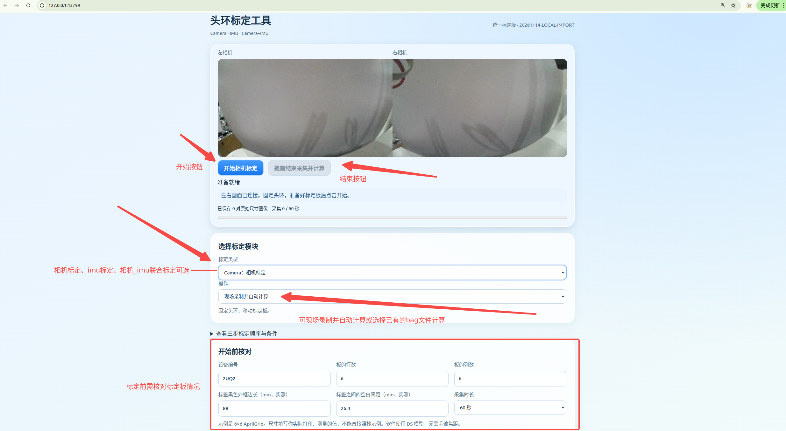
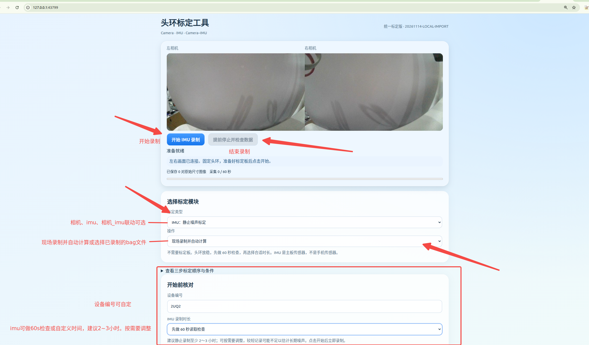
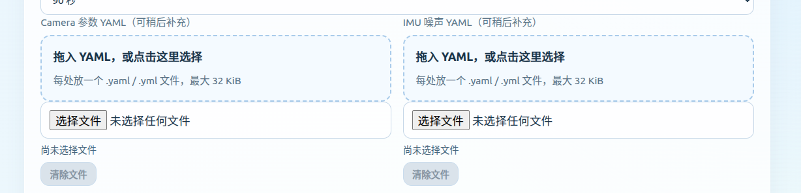
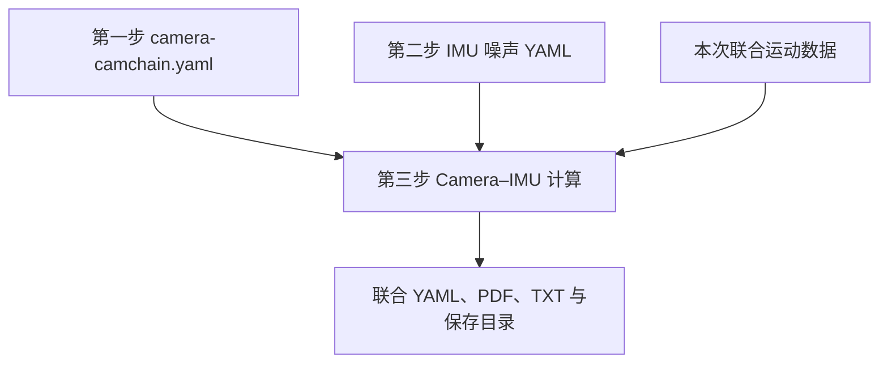

[English](README.md)

> **当前预发布版本：** Android code20 已构建；Linux `20261115-PROCESS-WAIT` 已完成三项已有数据计算测试。两款 App 均以英文为首次使用默认语言，并保留中英切换及已保存偏好。新版已由 Blue88ight 公开为预发布版，安装文件和状态见[项目下载说明](../releases/README.zh-CN.md)。

# 相机与 IMU 标定 App 使用教程（Camera & IMU Calibration App README）

本文只介绍 Linux 统一标定工具。手机 App 的安装、日常录制和数据导出请看[数据采集 App README（Data Capture App）](../capture/README.zh-CN.md)。

本教程使用同一个“头环标定工具”完成 Camera、IMU、Camera–IMU。当前功能验证目标是：能够录制、计算并生成对应结果文件。额外的联合结果复核默认折叠，不是正常操作的必填步骤。

版本基线：**20261115-PROCESS-WAIT**。头环 USB 直接连接 Linux 电脑，不经过手机 App。Ubuntu 22.04 / 24.04 桌面版、x86_64 是安装脚本支持范围；已有新 Ubuntu 22.04 的计算实测，其他系统需自行适配。

先完成 [硬件准备（Hardware Setup）](../hardware/README.zh-CN.md)，再按 [标定板说明（Calibration Targets）](../calibration-targets/README.zh-CN.md) 打印和实测。A4 版通常填 25 mm / 7.5 mm，大版通常填 88 mm / 26.4 mm，均以打印实测为准。

## 第一次使用先选一条路线

| 你的情况 | 按什么顺序做 | 先准备什么 |
|---|---|---|
| 全新 Ubuntu，还没装工具 | 第 1～3 节安装并打开，再做第 5 节 Camera | 完整安装包、数据线和实测标定板 |
| 已安装，要新录制 | 第 4 节认识页面，按第 5、6、7 节做对应模块 | 头环；Camera 和联合步骤还需板 |
| 手里已有录制，不想重录 | 第 8 节导入，然后按对应模块计算 | Camera 用 BAG；IMU 用成对 CSV+JSON；联合用数据和两份 YAML |
| 前两步已有结果，要做第三步 | 第 7 节 | `camera-camchain.yaml` 与适用的 IMU 噪声 YAML |

每个模块都按“设置 → 开始 → 动作 → 停止 → 等待计算 → 找到结果”操作。先做一项再切下一项。每次计算完成，把页面显示的**结果保存目录**记下来。

### 看中文图时先切换语言

当前版本首次默认英文。页面标题旁点 **中文** 后，可按本文中文按钮名操作；下表也给出英文对应项。图片使用你提供的真实操作图，点图片可查看原图、放大红色箭头。Camera/IMU 截图来自较早的 LOCAL-IMPORT 版，用于说明控件位置；本文的输入要求和行为按当前 PROCESS-WAIT 源码核对。第三步当前支持先录制、后补参数。

| 中文页面文字 | 英文页面文字 | 所在区域 |
|---|---|---|
| 标定类型 | `Calibration type` | 选择标定模块 |
| 操作 | `Operation` | 选择现场录制或已有数据 |
| 已有录制，直接计算 | `Calculate from an existing recording` | 操作下拉框 |
| 选择本地文件 | `Browse local files` | 已有录制导入区 |
| 选择录制文件夹 | `Browse recording folders` | 已有录制导入区 |
| 开始计算 | `Start calculation` | 预览旁主按钮 |
| 打开结果文件夹 | `Open result folder` | 处理结果区 |

## 1 准备

- 一套配套 2UQ2 双目头环和数据线。两个镜头及主板固定可靠；录制中不要相对滑动。
- 平整、无明显反光的 AprilGrid；核对行列、实际黑色标签边长与空隙。IMU 静止步骤不需要板。
- 电脑联网、知道 sudo 密码，关闭自动休眠。初次建议至少留 30 GiB 空间；录制和环境下载期间按实际提示预留更多。
- 关闭手机端或其他占用头环的程序。普通用户不需要 GitHub 登录、宿主 ROS、Android Studio 或 GPU。

## 2 下载、安装与更新（Download & Install）

### 从发布页下载到首次打开

下面下载和命令都在 **Ubuntu 标定电脑**完成。

1. 打开[当前 Linux 完整安装包发布页](https://github.com/EgoOneLabs/Ego-Calib-Tools/releases/tag/camera-easy-v1.9-bilingual)，向下找到 **Assets**，点小三角展开。
2. 分别点 **camera.zip** 和 **camera.zip.sha256**，等两个文件都下载完成。完整 ZIP 约 1.8 GB；文件名仍有 `.part`、`.crdownload` 或浏览器显示正在下载时先等待。
3. 在文件管理器中打开下载文件夹，把这两个文件放在同一个新文件夹，例如 `headband-install`。确认文件名没有被自动改成 `camera (1).zip`；若改名，优先将这次文件单独放入新文件夹并恢复对应名称。
4. 在该文件夹空白处右键，选“在终端打开”。以下命令依赖当前目录，终端里应能看到这两个文件：

```bash
ls -lh camera.zip camera.zip.sha256
sha256sum -c camera.zip.sha256
```

5. 看到 `camera.zip: 成功` 或 `camera.zip: OK` 后，依次执行以下命令，每一条成功后再执行下一条：

```bash
sudo apt-get update
sudo apt-get install -y unzip
unzip camera.zip
bash camera.run --check
bash camera.run
```

6. `sudo` 要求的是这台 Ubuntu 的登录密码；输入时没有圆点或星号也正常，输入完按回车。不要用 `sudo bash camera.run` 启动安装器。
7. 出现完整包自检通过后，安装器继续配置系统依赖、USB 权限和 Kalibr 环境。保持联网与终端打开，等待浏览器自动打开本地工具。终端若报错并退出，保留具体报错，按第 10 节处理。
8. 首次权限未生效时重新插拔头环；提示用户组未生效时注销 Ubuntu 后重新登录，再从应用菜单打开工具。确认左右画面在变化。

**本步检查点**：页面能打开、版本为 PROCESS-WAIT、两路预览能持续更新。你的浏览器地址应是自己的 `127.0.0.1` 本地地址，端口由启动程序分配。后续无需重新下载或解压安装包，按第 3 节启动。

已有旧工具时，先等待录制和计算结束，在启动终端 Ctrl+C 退出，再运行同一安装入口。旧数据保留，实际数据挂载和结果路径以页面为准。

<details>
<summary>高级/备用：已有环境的轻量更新与源码部署（Advanced / Fallback）</summary>

已有 Kalibr 环境或维护者开发时，可下载 [`install-calibration.sh`](https://github.com/EgoOneLabs/Ego-Capture/blob/feat/english-default-code20/docs/downloads/install-calibration.sh)、[`headband-calibration.zip`](https://github.com/EgoOneLabs/Ego-Capture/blob/feat/english-default-code20/docs/downloads/headband-calibration.zip)、[校验文件](https://github.com/EgoOneLabs/Ego-Capture/blob/feat/english-default-code20/docs/downloads/headband-calibration.zip.sha256) 到同一文件夹，在该文件夹运行 `bash install-calibration.sh`。小包不包含镜像；新机缺环境时此入口会联网下载已发布的旧环境分卷，仅提取镜像，不执行旧 App。

源码克隆、分支和工具链见[开发说明](../guides/DEVELOPMENT.zh-CN.md)。普通用户优先使用上面的 Release 完整包。

</details>

## 3 以后如何启动和退出

在应用菜单搜索“头环标定工具”，或执行：

```bash
gio launch "$HOME/.local/share/applications/ego-camera-calibration.desktop"
```

浏览器地址为 `http://127.0.0.1:实际端口`，每次端口可能不同，不要收藏一个旧端口当作永久入口。启动终端需要保持打开。关闭网页不会删除数据，也不一定停止任务；退出程序在启动终端按 Ctrl+C。

出现 USB 权限提示时按指引操作；首次可重新插拔头环，必要时注销并登录以生效 docker/video 用户组。画面和状态都正常后再开始，不要同时启动多个实例。

## 4 认识页面和两种操作方式


图示来自 LOCAL-IMPORT 版，按钮位置和模块选择仍适用；当前 PROCESS-WAIT 版允许第三步先录制，录制按钮名称随参数是否齐全变化。

| 操作 | 怎么用 |
|---|---|
| 现场录制 | USB 连接头环，填写设置，点击预览旁开始；结束后自动计算，或在缺少联合参数时先保存 |
| 已有录制，直接计算 | 拖入文件/文件夹，或点击“选择本地文件”“选择录制文件夹”；导入完成后点击开始计算 |

开始、结束、动作提示和进度在实时预览旁。计算过程会显示实际终端输出；没有新日志不一定代表程序卡死。结束后显示文件链接、实际目录和“打开结果文件夹”。

推荐 Camera → IMU → Camera–IMU；Camera 与 IMU 可交换顺序。联合运动数据也能先录，**联合计算时**才需要前两项参数。

## 5 Camera 相机标定



### 对着 Camera 图逐项填写

先看图中红色箭头指向的“标定类型”和“操作”，再看红框中的“开始前核对”。设置完成后回到预览下的开始按钮。

| 页面字段 | 第一次怎么填 | 核对方法 |
|---|---|---|
| 标定类型 | 选 Camera | 操作提示变成“固定头环，移动标定板” |
| 操作 | 选现场录制并自动计算 | 开始按钮用于录制，而非导入计算 |
| 设备编号 | 本台实际编号 | 与后续 IMU、联合步骤保持一致 |
| 板的行数、列数 | 当前附带板均为 6、6 | 每行数 6 个标签，每列数 6 个标签 |
| 标签黑色外框边长 | 填实测 mm | 大版标称 88，A4 标称 25；量的是单个标签黑框 |
| 标签之间的空白间距 | 填实测 mm | 大版标称 26.4，A4 标称 7.5 |
| 采集时长 | 首次可选 60 秒 | 这是一轮录制的时长，后面还需等待计算 |

**60 秒动作示例**：前 10 秒让板在中央清晰可见；接着约 20 秒缓慢移到左右、上下与角落；再约 20 秒改变远近和板的倾斜方向；最后回到较稳定位置。此分配用于帮助第一次操作，实际以图案清晰、视角覆盖和两路可见为准。

录制时看预览旁的图像对数和已录制时间持续增长。到时自动停止后，继续等待 BAG 整理和求解。出现实时计算日志时保留终端与网页，直到看到处理完成、结果链接及实际保存目录。

**拿到下一步文件**：在页面点 `camera-camchain.yaml` 可下载一份；点“打开结果文件夹”可找到原文件。把它和报告一起保留，第三步左侧 Camera 参数框使用这份 YAML。若仅有 BAG 而缺少 YAML，先按错误日志排查这次计算。

**动作：头环固定，移动标定板。** 此步骤求相机成像参数及左右相机相对关系，不需要 IMU 参数文件。

1. 选择 `Camera：相机标定`，操作选现场录制。
2. 填设备号，核对板的行数、列数，以及实测黑色外框边长与白色空隙，单位都是 mm。
3. 选择 60 / 90 / 120 秒，确认两个画面都能清楚看到图案。
4. 点击“开始相机标定”。先让板在中央，再缓慢覆盖四边、四角；改变远近，加入左右和上下倾斜、面内旋转。
5. 尽量让两眼同时看到板；不要求每帧全板都可见，但标签需要清晰。避免反光、纸弯曲和快速运动。
6. 到时自动结束；保存足够图像后也可提前结束并计算。至少 40 对只是程序允许提前结束的条件，不是质量通过门槛。
7. 等待 BAG 整理、逐帧读回和 Kalibr DS 双目求解，打开结果目录。

| Camera 输出 | 用途 |
|---|---|
| `camera.bag` | 左右相机输入数据 |
| `camera-camchain.yaml` | 双目内参和相机间外参；第三步左侧需要这个文件 |
| `camera-report-cam.pdf` | 标定报告 |
| `camera-results-cam.txt` | 参数与误差摘要 |
| `aprilgrid.yaml` | 本次板配置 |
| `bag_verification.json`、`calculation.json`、日志 | 文件、运行状态与耗时记录 |

预览是彩色，标定图像可保存为每眼原尺寸灰度图；这不是黑白显示故障。无需手动输入焦距。已有 BAG 重算直接选择对应 BAG；若没有随附板配置，使用点击计算时页面上的实测尺寸。

## 6 IMU 静止噪声分析

**动作：保持头环静止。** 不用板，不用 Camera 参数。读取的是头环主板 IMU，不是电脑或手机传感器。



### 对着 IMU 图选时长并检查结果

图中开始/结束按钮仍在预览下面。先把“标定类型”改成 IMU，页面会收起板尺寸字段并显示 IMU 录制时长。

| 目的 | 怎么选 | 完成后看哪里 |
|---|---|---|
| 第一次检查能否读取 | 选“先做 60 秒读取检查” | 有效样本、错误、缺口和重复统计，以及分析结果或具体错误 |
| 用已有成功数据测试分析 | 选“已有录制，直接计算”，按第 8 节导入 | Allan CSV、分析 JSON、PDF、TXT |
| 需要观察长期噪声 | 选 2 小时、3 小时或自定义 | 逐轴拟合与是否生成候选 YAML |

点击开始后，设备和线缆都保持静止。录制到时会进入分析，分析完成后往下看“处理结果”和文件链接。若显示 `IMU_ANALYSIS_NEEDS_REVIEW`，先看逐轴说明：生成曲线和报告表示分析已运行，但完整噪声 YAML 可能没有生成。

**本步检查点**：备份 `imu_samples.csv` 与 `imu_capture.json`，保留分析报告。只有实际生成了适用的 `imu-candidate.yaml` 或明确选择了实验权重文件，才把该 YAML 放入第三步右侧框。短录制仅检查软件功能时，无需为重复计算强制重新采集两小时。

1. 选择 `IMU：静止噪声标定`，填设备号。
2. 头环放在稳固台面，线缆留松。姿态不用严格水平，以能长期放稳为准。
3. 首次选 60 秒读取检查。确认样本、错误、重复和缺口统计可用，再进行长记录。
4. 正式分析建议静止记录 2～3 小时，也可选择自定义分钟/小时，当前支持 1 分钟～24 小时。**立即开始，不预热；两小时不是不可突破的硬性门限。** 短记录可能不足以辨认长期噪声。
5. 点击“开始 IMU 录制”。期间不要碰设备、敲桌子或拖线；保持供电，关闭休眠。
6. 到时自动分析，也可提前停止。软件按连续片段处理，缺口不补零、不删除真实时间间隔拼接。
7. 查看 Allan 曲线、逐轴拟合说明及输出目录。

| IMU 输出 | 用途 |
|---|---|
| `imu_samples.csv`、`imu_capture.json` | 已有数据重算所需的一组输入 |
| `imu_packets.bin`、`imu_requests.csv` 等 | 原始包和读取诊断 |
| `imu-allan.csv`、`imu-report.pdf` | Allan 曲线数据与图 |
| `imu-analysis.json`、`imu-results.txt` | 分析状态及逐轴结果 |
| `imu-candidate.yaml` | 满足当前候选生成条件时才存在，不保证每次生成 |
| `imu-experimental.yaml` | 明确选择实验混合模型生成的权重，不能等同正式噪声验收 |

如果报告显示某轴“未识别”，先保留数据和曲线；不能据此断言硬件坏了，也不要把 TXT / JSON 改扩展名冒充 YAML。IMU 静止分析不等于完整的比例因子、轴向、偏置和温度标定。

### 没有 IMU 噪声 YAML，第三步怎么办

- 已生成 `imu-candidate.yaml`：保存此文件，第三步选它作为 IMU 输入；候选仍需结合报告判断。
- 本轮只验证联合计算流程、明确接受实验权重：**现场 IMU 分析完成后**，在“结果文件”的逐轴噪声表下点击 **“生成实验混合模型权重”**。生成成功后下载 `imu-experimental.yaml`，并一并保留 `imu-experimental-fit.json`；第三步使用这份 YAML。
- 按钮报“可用时间范围不足”或拟合失败：保留原数据和错误，此次尚无可用权重。不要改文件名、填零或借用其他设备参数继续；按数据报告决定补充观测或使用已经适用于同台设备的有效参数。

**已有 IMU 数据重算的页面目前没有相同的实验生成按钮。** 若已有结果缺少候选、又明确要做实验流程验证，可使用下面的备用命令；它调用已安装版本自带的同一拟合模块，不需要重新录制。否则先保留结果，待有适用 YAML 后再算第三步。

<details>
<summary>备用：从已有 IMU 分析结果生成实验权重（Experimental Fallback）</summary>

先在页面点击“打开结果文件夹”，复制这次分析结果的真实目录。目录中必须已有 `imu-allan.csv` 和 `imu-analysis.json`，不是仅有原始 CSV 的录制目录。如果已有 `imu-experimental.yaml`，直接复用，不要再次生成。

```bash
# Linux 标定电脑；【每次修改】只改 RUN，填页面显示的本次 IMU 分析结果目录
(
  set -euo pipefail
  RUN="/实际的/IMU分析结果目录"
  /usr/bin/python3 - "$RUN" <<'PYCODE'
from pathlib import Path
import shlex
import subprocess
import sys

run = Path(sys.argv[1]).expanduser().resolve()
for name in ('imu-allan.csv', 'imu-analysis.json'):
    if not (run / name).is_file():
        raise SystemExit('分析结果缺少文件：' + str(run / name))
entry = Path.home() / '.local/share/applications/ego-camera-calibration.desktop'
if not entry.is_file():
    raise SystemExit('未找到当前工具的桌面入口，请先按安装教程完成安装。')
command = next((line[5:] for line in entry.read_text().splitlines()
                if line.startswith('Exec=')), '')
args = shlex.split(command)
if len(args) < 2:
    raise SystemExit('桌面入口格式无法识别，请保留入口内容反馈维护者。')
module = Path(args[1]).parent / 'imu_experimental.py'
if not module.is_file():
    raise SystemExit('已安装版本缺少实验模块，请更新到当前统一工具。')
subprocess.run(['/usr/bin/python3', str(module), str(run)], check=True)
print('实验权重：', run / 'imu-experimental.yaml')
PYCODE
  xdg-open "$RUN"
)
```

实验拟合仍可能因数据支持不足而失败，且不会覆盖已有实验结果。该操作不把实验参数升级为正式噪声验收；生成后仍按上面的第三步输入要求使用。

</details>

## 7 Camera–IMU 联合标定

### 按这张文件对应图准备第三步



两份参数框位置参考（较早版本真实截图）；左侧放相机 YAML，右侧放 IMU 噪声 YAML。当前版本以各框下显示的文件名确认选择。



1. 在文件管理器中打开第一步的结果文件夹，找到 `camera-camchain.yaml`。PDF、TXT 用于阅读，拖入参数框的是 YAML。
2. 打开第二步结果，找到适用的 `imu-candidate.yaml`；若本轮明确使用实验权重，则找到 `imu-experimental.yaml`。没有此类文件时先按第 6 节处理。
3. 页面选第三步 Camera–IMU。找到“两份计算参数”区域，将相机 YAML 拖到**左侧 Camera 参数框**，IMU YAML 拖到**右侧 IMU 噪声参数框**。
4. 也可分别点框内的选择提示，从文件选择窗口中进入相应结果目录并选文件。每框放一个 YAML，单个文件最大 32 KiB。
5. 看每个框下面显示的文件名，确认左右没有放反。若页面自动带入旧文件，也要核对名称和适用设备。传错时点该框“清除文件”，重新选。
6. **现场录制**时，这两份参数可稍后补；**已有数据开始计算**时，须同时有联合数据和这两份参数。录完缺参数时先记下原始录制目录，稍后按第 8 节选这一段数据继续。

### 90 秒联合运动示例

以下时间帮助安排动作，不是质量通过条件。固定板，让整套头环移动，主板与相机一起运动。

| 录制阶段 | 做什么 | 同时观察什么 |
|---|---|---|
| 开头约 5 秒 | 拿稳框架、短暂停住 | 两路能看清板 |
| 接着约 20 秒 | 缓慢左右转向，往返几次 | 避免板始终离开画面 |
| 接着约 20 秒 | 上下点头，往返几次 | 标签保持清晰 |
| 接着约 20 秒 | 左右侧倾，再做平滑组合旋转 | 整套框架一起动，线缆不拉扯 |
| 余下时间 | 加少量前后/左右平移，最后短暂停住 | 不猛烈甩动，不用手单独托主板 |

两份参数已齐时点“开始录制并计算”，到时等待求解。缺参数时点“开始联合录制”，结束后先保存数据。已有录制计算成功时，在结果区应看到 `joint-camchain-imucam.yaml`、联合 PDF/TXT 和实际保存目录；记录方式不同可能使用旧前缀，以页面为准。

**动作：标定板固定，整套头环移动。** 主板和相机在本次录制中保持相对固定。若主板重新粘过，与旧外参不同可能是装配变化；当前不把跨装配结果一致当作方法跑通条件。

### 需要的两个计算参数

| 页面区域 | 拖入文件 | 来源 |
|---|---|---|
| Camera 参数 | `camera-camchain.yaml` | 第一步相机计算输出 |
| IMU 噪声参数 | `imu-candidate.yaml` 或明确标记的 `imu-experimental.yaml` | 第二步生成或已保存的对应参数 |

不需要把 Camera 的 PDF、TXT 拖入，也不要求先完成额外独立复核。参数须与本台设备及适用配置对应，不能随意借用其他头环。

### 现场录制

1. 选择第三步 Camera–IMU，操作选现场录制。
2. 核对设备号、板尺寸，选择 60 / 90 / 120 秒。
3. 两个参数齐全：按钮显示“开始录制并计算”，录完自动求解。参数未齐：显示“开始联合录制”，仍可先录，结束后保存目录。
4. 固定板，拿稳框架。开头短暂静止后，依次做左右摇头、上下点头、左右侧倾，再做平滑组合旋转和少量前后/左右平移。
5. 两路尽量持续看清板，运动应有速度变化，避免猛烈甩动、冲击、拖影；不要求每帧提取全部角点。
6. 到时或主动结束后等待保存。缺参数时，选择“已有录制，直接计算”，选刚才的数据并补两份 YAML，再点击开始计算。无需为了补参数重复录制。

| 联合输出 | 用途 |
|---|---|
| 联合 BAG | 图像和 IMU 共同输入 |
| `joint-camchain-imucam.yaml` | 相机–IMU 外参、时间偏移等联合输出；旧版前缀可能为 `camera_imu-` |
| `joint-report-imucam.pdf` | 联合报告 |
| `joint-results-imucam.txt` | 参数与残差摘要 |
| `job_status.json`、`job.log`、小检查包 | 任务状态与排障资料 |

结果文件名以页面实际生成项为准。原始联合录制与求解可能位于不同的新目录；页面分别显示保存位置。当前时间映射、IMU 单位/轴向和实验噪声参数有明确边界，不能仅凭文件生成宣称硬件同步或最终精度验收。

## 8 已有数据如何导入

### 从电脑本地选文件的完整顺序

1. 先在“标定类型”选 Camera、IMU 或 Camera–IMU，随后在“操作”选“已有录制，直接计算”。页面出现“选择已录制的数据”。
2. 打开电脑文件管理器，进入**单次录制**目录。可以把所需文件拖入页面的大虚线框，也可以点“选择本地文件”。
3. Camera 在文件窗口中选一个 `.bag`。若要同时带板配置，按住 Ctrl 再选 `aprilgrid.yaml`。IMU 必须同时选 `imu_samples.csv` 与 `imu_capture.json`；按住 Ctrl 点两个文件，再点“打开”。
4. 想选整个录制文件夹时点“选择录制文件夹”，进入目标文件夹并确认浏览器的读取提示。选具体这一轮录制，避免选包含多台设备或多轮录制的上级目录。
5. 等导入进度完成，看页面显示的已选路径和状态。大 BAG 复制需要时间，期间保留网页和启动终端。报缺文件时按提示补齐，再重新选择。
6. Camera 核对板尺寸；IMU 核对是静止数据；联合再确认下方两份 YAML。随后点预览旁“开始计算”。按钮灰色时，把鼠标停在按钮上看提示，按提示补数据或参数。
7. 往下看实时计算过程，完成后点“打开结果文件夹”。这次计算会有自己的新结果目录，源录制保留。第一次使用无需从“已发现录制”下拉列表寻找刚导入的文件。

**本步检查点**：页面已明确选中这一轮数据，计算结束后有对应输出和保存路径。把 Camera BAG、IMU CSV/JSON、联合 BAG 当成三种不同输入，按下表选齐。

| 模块 | 拖入或选择什么 |
|---|---|
| Camera | 一个 ROS1 相机 `.bag`；可同时选择 `aprilgrid.yaml`；或包含这些文件的单次录制文件夹 |
| IMU | 选齐 `imu_samples.csv` 与 `imu_capture.json`；或完整静止录制文件夹。不是任意 IMU BAG 导入器 |
| Camera–IMU | 一个联合 BAG，或完整原始录制文件夹（图像、清单、CSV、时钟和采集元数据），并另选两份计算 YAML |

拖放文件夹与点击“选择录制文件夹”均可。导入完成后自动选中数据，不必再到列表查找；“或从已发现的本机录制中选择”为快捷列表。导入中显示文件与百分比，可取消；原文件保留。

导入通过本地网页分段复制到本机 `imports/` 数据目录，不上传互联网。一次最多 20000 个文件、总计 100 GiB；需有导入和计算副本空间。保持页面和终端打开，别把多个任务的上级文件夹当作单次数据。

BAG 约定话题为 `/cam0/image_raw`、`/cam1/image_raw`；联合 BAG 另含 `/imu0`。图像为 `sensor_msgs/Image`，IMU 为 `sensor_msgs/Imu` SI 单位。程序检查结构与时间记录，不自动改话题、猜单位或修补回跳。

## 9 可选复核和结果交付

### 跑完以后在什么位置找文件

“录制完成”和“计算完成”分别看。录制时得到的是原始数据，计算时还需要等待对应模块的参数或分析报告。计算区出现结束信息后：

1. 找“结果保存目录”，复制整条路径或记下来。原工作站可能在 `/home/key/文档/kalibr/data/`，新安装默认位置可能不同，以页面为准。
2. 点“打开结果文件夹”，文件管理器应打开这一轮结果目录。也可点页面蓝色文件名下载副本；浏览器下载目录与工具的原始结果目录是两个位置。
3. Camera 保留相机 YAML/PDF/TXT；IMU 保留成对原始输入、Allan 与分析报告及实际生成的参数；联合保留联合 YAML/PDF/TXT 和两份输入参数。
4. 把路径、设备号、板尺寸和文件一起归档。仅做本轮功能测试时，确认流程与文件输出即可按功能结果记录；长期噪声和精度结论按报告另行判断。

如果只有 `job_status.json` 或日志，或页面明确报缺少 YAML，先展开错误详情与实时日志，记录真正报错。不要把文件存在、进度 100% 或一张截图单独当作计算成功。

“可选：联合标定结果复核”只在第三步底部，默认折叠。已有联合参数时，可用另一段独立运动记录检查固定外参和时间偏移下的残差；它不是正常采集、计算的必填项。

当前功能验证完成条件：录制正常结束，计算无异常退出，模块实际输出文件及保存路径完整出现。不要把只有原始录制、缺少 YAML 的状态当作联合计算已完成。参数精度判断另看报告与实际用途，不在本轮强行追加精度研究。

归档时保留设备号、软件版本、板实测尺寸、输入参数、报告和日志。大 BAG 与图像可单独备份，小检查包适合反馈问题。新电脑默认根目录为 `~/EgoStereoIMU/calibration_data/`，原工作站可能复用容器原 `/data` 挂载位置，**以页面实际路径为准**。

## 10 排障

| 现象 | 优先处理 |
|---|---|
| 第三步准备就绪但开始灰色 | 确认版本为 RECORD-FIX；该版不因缺两份 YAML 禁止现场录制。若是已有数据计算，则先选数据和补参数 |
| 不能提前结束 | 相机/联合至少保存 40 对图像；也可等待设定时长自动结束 |
| 导入缺文件 | 按具体模块说明选齐文件；联合原始目录不能只给 CSV，IMU 不要只给分析报告 |
| 报缺少结果 YAML | 展开本次计算日志找真正错误；缺输出只是结果，不应直接归因于板尺寸 |
| 设备无画面 | 检查数据线、USB 权限、设备占用、重新插拔；不要同时启动两个实例 |
| 磁盘不足 | 先备份旧数据，再清理或换数据盘；不要在传输中拔盘或删除正在计算的输入 |
| Git / rosdep 环境错误 | 使用当前统一安装入口；保留日志，不反复手动重装整套环境 |

[返回项目总览](../../../README.zh-CN.md) · [数据格式（Data Formats）](../guides/DATA_FORMAT.zh-CN.md)
