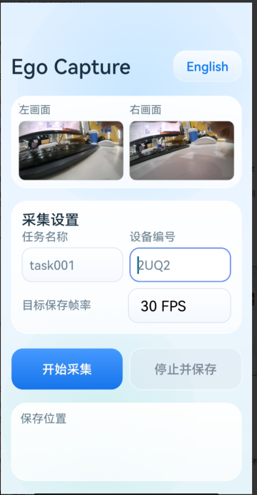

# Data Capture App README

[简体中文](README.zh-CN.md) · [Project overview](../../../README.md) · [Linux calibration](../calibration/README.md)

> **Android phones only:** Android 12 or later, arm64-v8a (64-bit), and USB Host / OTG. The APK does not run on iPhone, iOS or HarmonyOS NEXT.

This guide covers phone installation, connection, recording and backup. Ordinary recording does not require calibration or a Linux computer. The current public pre-release is code20 (`0.3.9-english-default`), package `com.egouvc.phone`. Its build and reference-phone evidence are recorded in Validation. Obtain the APK from Release Downloads.

## Complete your first capture in this order

Start with a 20–30 second test. Follow “install on the phone → connect the headband → enter two names → start → stop and save → back up on the computer”. Each step below identifies the device to use and the visible checkpoint. Daily phone capture can start at section 1.

| Current position | Next action | Check before continuing |
|---|---|---|
| App not installed | Section 2: download and install the APK | Ego Capture appears on the phone and opens |
| App open | Sections 2–3: connect and authorize USB | Both live views keep updating |
| Live views working | Section 4: record 20–30 seconds, then stop | Saved location shows a session directory |
| Final path displayed | Section 5: connect the phone to the computer and copy data | A complete session directory appears on the computer |
| Copy finished | Section 6: play the videos and inspect files | Both videos play; timestamps and IMU files accompany them |

### Read the screenshot

The supplied real screenshot shows the Chinese interface. Code20 initially opens in English; the table maps the visible Chinese labels to the English controls. Tap an image to view it at full size. Task names, device IDs and paths will differ for your recording.



| Chinese label in the image | English control | Action |
|---|---|---|
| 中文 / English | Language button beside the title | Choose the interface language |
| 左画面 / 右画面 | `Left view` / `Right view` | Move your hand or the target in front of each camera and check for updates |
| 任务名称 | `Task name` | For the first test, use `test_first` |
| 设备编号 | `Device ID` | Enter this headband's actual ID and reuse it consistently |
| 目标保存帧率 | `Target frame rate` | Select `30 FPS` for the first test; inspect the actual saved rate later |
| 开始采集 | `Start Capture` | Click once when both previews work |
| 停止并保存 | `Stop and Save` | Click once, then wait for export |
| 保存位置 | `Saved location` | Record or copy the final session path |

Saved location is blank in this reference screenshot. During your test, wait until the same area contains a specific final directory.

## 1. Prepare the hardware

Use the matching 2UQ2 stereo headband, mainboard, ribbon cables and a data-capable OTG cable. Disconnect power before adjusting cables. Secure both cameras and the mainboard to the frame, leaving slack in the cables. Connect the headband to either the phone or the Linux computer, not to competing capture programs. The IMU is on the headband mainboard, not in the phone.

Huawei STG-AL00 is the tested reference phone. Other models require a short compatibility test. A Type-C connector alone does not establish OTG support. See [Hardware Setup](../hardware/README.md).

## 2. Install the APK

### Download on the phone step by step

1. **On the Android phone**, open the [code20 APK release](https://github.com/EgoOneLabs/Ego-Capture/releases/tag/v0.3.9-code20). Scroll to **Assets** and expand it if necessary.
2. Tap **Ego-Capture-code20-debug.apk**. Choose this APK to install the app. The Source code archives are developer downloads.
3. Wait for the download to finish. Open the browser download notification or the phone's file manager and Downloads folder, then tap the APK. Menu names vary between phones.
4. If installation from this source is blocked, follow the phone's prompt to allow the browser or file manager you used, then return to installation. Debug-build notices vary by phone; check the release page, filename and version.
5. Tap Open after installation. Code20 initially uses English; the title-area button switches to Chinese when needed.
6. **Connect the headband to the phone**. Allow the required camera, USB and microphone permissions. If neither USB authorization nor live previews appear, check the data/OTG cable and reconnect.

**Checkpoint**: the app opens and both camera views update continuously. If either condition fails, use section 8 before recording.

[Current download status and checksums](../releases/README.md)

<details><summary>Optional: install using ADB on Linux</summary>

Enable Developer options and USB debugging on the phone. Connect it to the computer and approve the computer's debugging request on the phone.

```bash
sudo apt-get update && sudo apt-get install -y adb
adb devices -l
adb install -r "$(xdg-user-dir DOWNLOAD)/Ego-Capture-code20-debug.apk"
```

Proceed only when the device state is `device`. With multiple phones, use `adb -s ACTUAL_SERIAL ...`. Back up before troubleshooting; do not uninstall or clear app data as a routine fix.

</details>

## 3. Understand the capture screen


The single-page interface contains the title/language switch, stereo preview, task and device fields, target save rate, recording controls and final path.

| Setting | What to enter |
|---|---|
| Task | A recognizable name such as `task001` or `indoor_walk`; avoid path separators |
| Device | The actual headband ID, kept consistent across recordings |
| Target save rate | 30, 15 or 10 FPS; a target, not a guarantee of sustained frame rate |
| Language | English or Chinese; saved preferences are respected |

## 4. Make a short recording

### Record a session named test_first

| Order | What to enter or tap | Expected visible state |
|---|---|---|
| 1 | Enter `test_first` in Task name | The field retains the name |
| 2 | Enter the actual Device ID | No slash, line break or `..` path component |
| 3 | Choose `30 FPS` and dismiss the phone keyboard | Both views and the start control are visible |
| 4 | Tap Start Capture and gently move the complete headband | Recording starts; names and rate settings are locked |
| 5 | After about 20–30 seconds, tap Stop and Save | Saving or export begins; wait for completion |
| 6 | Check Saved location at the bottom | A final path contains `test_first` and the new session name |

Saving/export prepares files locally on the phone. Duration varies with data volume, device performance and storage. If the app reports a failure, retain the original Episode and the exact message for troubleshooting. A saving state or .partial directory does not establish a completed export.

**Checkpoint**: wait for the final path before disconnecting the headband. For backup, move the phone's cable connection from the headband to the computer.

1. Confirm that both previews keep updating. Check battery and free space.
2. Enter task/device names and choose the target save rate.
3. Start recording. Names and frame-rate settings are locked during capture.
4. Record 20–30 seconds first. Keep the app in the foreground; do not lock the phone or open another USB/camera app.
5. Stop and save. Wait through saving/export; do not unplug, force-close or repeatedly press buttons.
6. Wait for the final session path, then long-press to copy it. A raw Episode directory or an enabled button alone is not proof that export succeeded.
7. Back up and inspect the complete session before starting a long task.

Audio availability depends on permissions and the actual input route. Missing audio does not by itself mean the video session was lost. No universal phone compatibility, background-recording or unlimited-duration guarantee is claimed.

## 5. Copy data to a computer

Final sessions:

```text
/storage/emulated/0/Android/data/com.egouvc.phone/files/data/<task>/<device>_session_<date-time>/
```

Raw Episodes:

```text
/storage/emulated/0/Android/data/com.egouvc.phone/files/episodes/episode_<date-time>/
```

Android file managers may restrict `Android/data`. ADB is the recommended backup method; it copies without deleting phone files.

1. Stop recording and wait for export to finish. Disconnect the headband, then connect the phone to the computer with a data cable.
2. Enable Developer options and USB debugging. Unlock the phone and approve this computer.
3. Install ADB and inspect the connection:

```bash
sudo apt-get update && sudo apt-get install -y adb
adb devices -l
```

The state must be `device`. For `unauthorized`, approve the prompt on the phone. For `offline`, check the cable and reconnect. For multiple devices, add `-s ACTUAL_SERIAL` after every `adb`. Resolve host USB permissions if reported.

### Find the task before copying

Record the task name, for example `test_first`, and the final session name shown under Saved location. Backup reads that session **from the phone**. The APK's download folder is a different location.

Run the following ADB commands in an **Ubuntu computer terminal**. Stop and save first, connect the unlocked phone to the computer and approve USB debugging. `adb devices -l` should report the state `device`.

```bash
# Ubuntu computer: list saved task names on the phone.
adb shell ls /sdcard/Android/data/com.egouvc.phone/files/data
# CHANGE test_first to the task name you actually entered in the app.
adb shell ls /sdcard/Android/data/com.egouvc.phone/files/data/test_first
```

If the directory is missing, check the task spelling, the displayed final path and export status. If the phone is unauthorized, approve the computer on the phone and retry. The complete backup commands below copy both exports and raw Episodes to reduce omissions on the first run.

### Copy the complete recording

After finding the task, copy both complete roots:

```bash
# Linux computer; the phone is connected and debugging is authorized.
(
  set -euo pipefail
  mkdir -p "$HOME/EgoCapture-backup"
  adb pull /sdcard/Android/data/com.egouvc.phone/files/data \
    "$HOME/EgoCapture-backup/"
  adb pull /sdcard/Android/data/com.egouvc.phone/files/episodes \
    "$HOME/EgoCapture-backup/"
  xdg-open "$HOME/EgoCapture-backup"
)
```

To copy only one task, replace `task001` below with the actual task name:

```bash
adb pull /sdcard/Android/data/com.egouvc.phone/files/data/task001 \
  "$HOME/EgoCapture-backup/"
```

Retain timestamps, IMU, audio metadata and `meta.json` with the videos. Check the computer copy before considering deletion on the phone.

## 6. Inspect the export

- `videos/left.mkv` and `videos/right.mkv` exist and decode.
- Timestamp files match the exported frame mapping.
- `imu/imu0.csv` and `imu/imu_raw_counts.csv` exist; inspect samples/gaps against metadata.
- If metadata reports valid audio, a complete WAV is present. Otherwise inspect `audio/audio_metadata.json`.
- The selected directory is final, not `.partial`, an export in progress or a failure-diagnostics directory.

Optional decoding check on Linux, after installing FFmpeg with `sudo apt-get install -y ffmpeg`:

```bash
# CHANGE THIS: use the actual session directory on the computer.
SESSION="/actual/path/to/session"
ffmpeg -v error -i "$SESSION/videos/left.mkv" -f null -
ffmpeg -v error -i "$SESSION/videos/right.mkv" -f null -
```

A successful decoding check does not establish frame rate, synchronization or calibration accuracy. See [Data Formats](../guides/DATA_FORMAT.md).

## 7. Include calibration files when needed

This is optional for ordinary capture. Prepare the applicable parameters for this exact device and assembly in a local `calibrations` folder, then copy them before recording:

```bash
adb shell mkdir -p /sdcard/Android/data/com.egouvc.phone/files/calibrations
adb push calibrations/. /sdcard/Android/data/com.egouvc.phone/files/calibrations/
```

The exporter copies an existing directory; it does not generate, match or accept parameters automatically. Make a short recording and confirm the files appear in the final session. Reattaching the mainboard may change camera–IMU extrinsics without necessarily invalidating camera intrinsics or stationary-noise observations.

## 8. Troubleshooting

| Symptom | Next action |
|---|---|
| No preview / USB permission | Check the OTG data cable and permissions; close competing apps, reconnect and tap the preview |
| One camera abnormal | Retain diagnostics and inspect ribbon connections; do not infer export corruption from preview alone |
| Saving takes time | Allow local splitting and disk writes to finish; check free space and retain raw Episodes |
| Unplugged after stopping | Local export is designed to continue without USB; inspect its actual completion before restarting |
| No audio | Inspect permission, input route and audio metadata; do not create a dummy WAV |
| `INCOMPLETE` or unsynchronized status | Read timing and export metadata; these flags do not mean all media files are missing |
