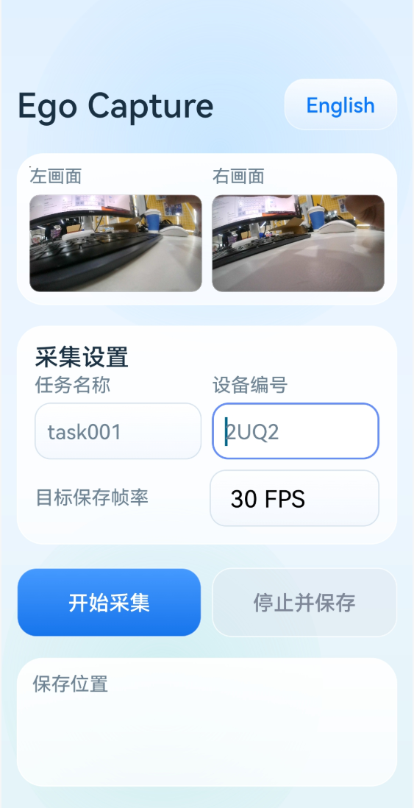

[English](README.md)

> **本地候选版本：** Android code20 已构建；Linux `20261115-PROCESS-WAIT` 已完成三项已有数据计算测试。两款 App 均以英文为首次使用默认语言，并保留中英切换及已保存偏好。新版尚未公开发布，安装文件和状态见[项目下载说明](../releases/README.zh-CN.md)。

# 数据采集 App 使用教程（Data Capture App README）

> **目前仅支持安卓手机：Android 12 及以上、arm64 64 位，并支持 USB Host / OTG。不支持 iPhone / iOS 和 HarmonyOS NEXT。**

本文只介绍手机采集：安装、连接、录制、保存和导出。普通采集无需先完成标定。Linux 标定请看[相机与 IMU 标定 App README（Camera & IMU Calibration App）](../calibration/README.zh-CN.md)。

本教程面向第一次使用 2UQ2 双目头环的用户。完成后应能在手机上看到左右连续画面，保存一次包含视频、头环 IMU 及可用音频的会话，并把完整数据复制到电脑。本地候选版本：code20 / 0.3.9-english-default，包名 `com.egouvc.phone`。

装配和线缆选择可先看 [硬件准备 README（Hardware Setup）](../hardware/README.zh-CN.md)。本教程按“准备 → 安装 → 认识界面 → 短录制 → 导出 → 检查”执行。

## 1 准备设备

准备配套的两个相机、主板、排线和头环框架。先断电安装排线，再将主板与两个相机牢固固定。录制期间各部件不应相对滑动；线缆留松并固定，移动框架时不要提拉主板或 USB 线。

手机需要 Android 12 或以上、arm64 64 位及 USB Host / OTG。当前 APK 仅包含 arm64-v8a 原生库。当前真机参考是华为 STG-AL00；其他手机先做短录制确认。HarmonyOS NEXT 和 iPhone 不运行当前 APK。连接线必须同时支持数据传输与 OTG，充电线可能不能使用。

头环同一时间接手机或 Linux 电脑中的一端；不能让两个采集程序争用设备。普通手机采集无需标定板，也不要求先完成三项标定。

## 2 下载和安装 APK

1. 发布后从 code20 Release 取得 `Ego-Capture-code20-debug.apk`；公开附件状态看[下载说明](../releases/README.zh-CN.md)。旧公开 code19 与本次版本不同。Source code ZIP 不是安装包。
2. 在手机“下载”中点击 APK。按系统提示允许此次来源安装；完成后打开 Ego Capture。
3. 按采集需要允许相机、录音和 USB 访问。拒绝权限后不会不断重复弹窗，可按系统设置调整，或轻触预览区域重试。
4. 将头环通过 USB 数据线接到手机。连接已授权设备后自动打开相机；出现左右连续画面后再设置任务。

[当前下载与校验说明](../releases/README.zh-CN.md)

使用 Linux 和 ADB 安装是可选方式。先在手机启用开发者选项和 USB 调试，再连接电脑并允许调试授权：

```bash
# Linux 电脑；APK 已放在系统下载目录
sudo apt-get update && sudo apt-get install -y adb
adb devices
adb install -r "$(xdg-user-dir DOWNLOAD)/Ego-Capture-code20-debug.apk"
```

若列出多台设备，在后续 `adb` 命令后加 `-s 实际序列号`。升级安装通常保留应用数据；不要为排障直接卸载或清除应用数据，先完成备份。

## 3 认识采集界面



code19 从上到下是标题和语言切换、左右并排预览、任务名与设备号、目标保存帧率、开始与停止、保存位置。界面保持竖屏单页；输入名称时预览会随软键盘缩小，收起键盘后恢复。

| 设置 | 填写方式 |
|---|---|
| 任务名称 | 填能识别用途的名字，例如 `task001` 或 `indoor_walk`；避免路径分隔符 |
| 设备编号 | 填本台头环实际编号，例如 `2UQ2`；同一设备保持一致 |
| 目标保存帧率 | 30 / 15 / 10 FPS；表示抽样保存目标，不代表实际稳定帧率 |
| 语言 | 右上角切换中文 / English，不修改用户输入和磁盘数据 |

自动连接和空闲 IMU 读取只说明设备已接入；开始录制必须由用户点击。预览看起来流畅不等于每路视频都稳定保存 30 FPS。

## 4 第一次录制

1. 确认左右画面都在持续更新，没有黑屏或明显异常。不要只看到一张旧画面就开始。
2. 填任务名和设备编号，选择目标保存帧率。确认手机有足够空间与电量。
3. 点击“开始采集”。录制时名称和帧率锁定，正式录制线程接管 IMU 读取。
4. 第一次先录 20～30 秒。保持 App 在前台，不锁屏、不切换到其他占用 USB / 相机的程序。
5. 点击“停止并保存”。出现“保存中…”后继续等待；不要重复点击、拔线或强制关闭 App。
6. 下方出现本次正式保存路径后，长按复制路径。只有原始目录存在或按钮恢复，不应直接当作正式导出成功。
7. 把会话复制到电脑，检查左右视频、时间文件、IMU CSV，以及音频元数据。短记录正确后再进行正式任务。

尽量在平稳供电和散热条件下采集。音频不可用时按元数据排查，不把缺少 WAV 直接解释成整个视频会话丢失。当前没有全机型、后台录制或任意时长稳定性的保证。

## 5 找到并导出数据

正式输出目录：

```text
/storage/emulated/0/Android/data/com.egouvc.phone/files/data/<任务名>/<设备号>_session_<日期时间>/
```

原始 Episode 位于：

```text
/storage/emulated/0/Android/data/com.egouvc.phone/files/episodes/episode_<日期时间>/
```

Android 对 `Android/data` 的文件管理器访问可能受限。推荐使用电脑 ADB 复制；复制不会删除手机文件。若前面直接在手机安装了 APK，也请先完成这里的电脑准备：

1. 在 App 点击停止并等待导出完成，再把头环与手机断开，用数据线把手机接到电脑。
2. 手机启用开发者选项和 USB 调试；按手机系统说明或设置搜索找到开关。在手机上确认当前电脑的调试授权。
3. Linux 电脑安装 ADB 并检查连接：

```bash
sudo apt-get update && sudo apt-get install -y adb
adb devices -l
```

列表应显示一台状态为 `device` 的手机。`unauthorized` 时解锁手机并确认授权；`offline` 时检查数据线和连接，直到设备状态正常。列出多台时在后续每条命令中使用 `adb -s 实际序列号 ...`。如系统提示 USB 访问权限不足，先按系统的 ADB/USB 权限说明处理，不使用反复卸载 App 的办法。

4. 确认电脑连接正常后，复制完整数据目录：

```bash
# Linux 电脑：手机连接电脑，已允许 USB 调试
(
  set -euo pipefail
  mkdir -p "$HOME/EgoCapture-backup"
  adb pull /sdcard/Android/data/com.egouvc.phone/files/data \
    "$HOME/EgoCapture-backup/"
  adb pull /sdcard/Android/data/com.egouvc.phone/files/episodes \
    "$HOME/EgoCapture-backup/"
  xdg-open "$HOME/EgoCapture-backup"
)
```

数据很多时，可只复制本次任务目录。把下面路径中的任务名改成实际值：

```bash
# 【每次修改】task001 改为本次任务名称
adb pull /sdcard/Android/data/com.egouvc.phone/files/data/task001 \
  "$HOME/EgoCapture-backup/"
```

先检查电脑上的完整目录，确认视频可播放、文件数和容量合理，再决定是否删除手机副本。不要只拷 MKV；时间文件、IMU、音频说明与 `meta.json` 必须一起留存。

## 6 怎么确认这次保存完成

- `videos/left.mkv`、`videos/right.mkv` 存在且可解码。
- 两份 `timestamps/*_timestamps.txt` 与对应导出视频帧数能对应。
- `imu/imu0.csv` 和 `imu_raw_counts.csv` 存在，结合元数据检查样本及缺口。
- 若 `meta.json` 表示音频可用，应存在完整 WAV；否则查看 `audio/audio_metadata.json` 的具体状态。
- 没有把 `.partial`、导出中目录或失败诊断目录当作最终会话。

开发者可在电脑用 FFmpeg 检查视频完整解码：

```bash
# 【每次修改】填入电脑上的实际会话目录
SESSION="$HOME/EgoCapture-backup/data/task001/实际会话目录"
ffmpeg -v error -i "$SESSION/videos/left.mkv" -f null -
ffmpeg -v error -i "$SESSION/videos/right.mkv" -f null -
```

没有错误输出表示该次解码没有报告错误，不等于已经验证帧率、时间同步或标定质量。

## 7 标定文件如何随采集保存

若维护者需要随会话附带参数，应先把本台设备对应文件放入手机应用的 `files/calibrations/`。有文件时导出器会复制该目录，但不会自动生成、匹配设备或验收这些参数。

```bash
# Linux 电脑；当前目录已有本台设备的 calibrations 文件夹
adb shell mkdir -p /sdcard/Android/data/com.egouvc.phone/files/calibrations
adb push calibrations/. /sdcard/Android/data/com.egouvc.phone/files/calibrations/
```

先核对文件属于同一套装配，再录一小段确认正式会话确实包含副本。主板重新粘接后可能需要更新 Camera–IMU 外参；仅主板位置变动不意味着相机成像参数和静止噪声一定要重录。

## 8 常见问题

| 现象 | 处理方法 |
|---|---|
| 没有预览或 USB 授权 | 检查 OTG 数据线和权限，关闭其他占用程序，重新连接后轻触预览重试 |
| 只有一路异常 | 保留现场和诊断，检查排线与镜头连接；不要仅凭预览猜测导出文件已损坏 |
| “保存中…”持续较久 | 等待本地拆分和写盘，确认剩余空间；先保留原始 Episode 和日志 |
| 停止后意外拔线 | 本地导出设计为不依赖 USB 继续，但仍需看实际保存结果；不要立即重启应用 |
| 没有音频 | 查看路由权限、录音设备和音频元数据；没有经过实际路由核对时不导出伪 WAV |
| `meta.json` 有 INCOMPLETE / 未同步状态 | 查看数据与时间语义，不把它直接解释成所有数据文件不存在；详见数据格式说明 |

[返回项目总览](../../../README.zh-CN.md) · [相机与 IMU 标定 App README（Camera & IMU Calibration App）](../calibration/README.zh-CN.md)
