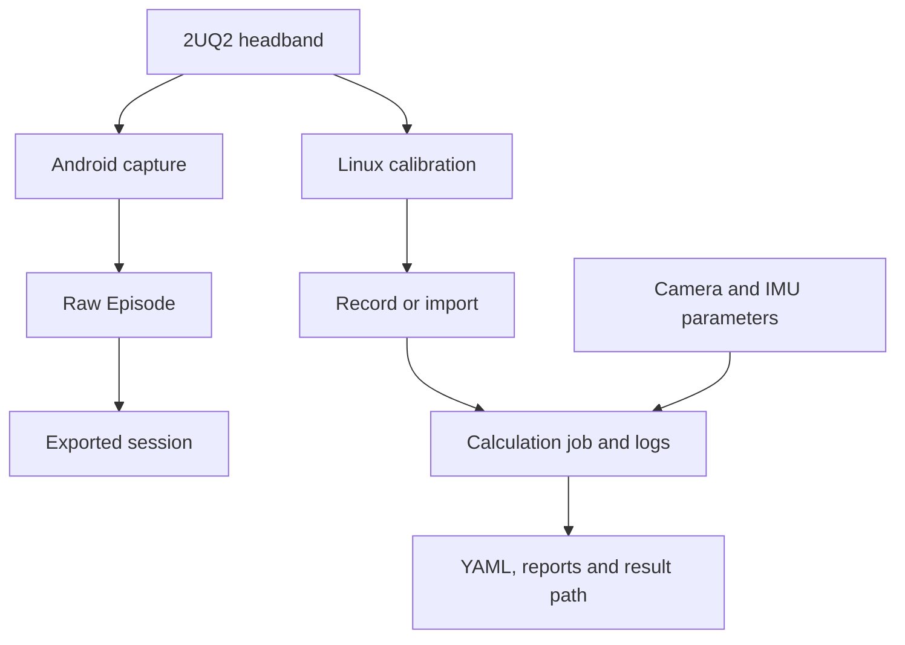

# Architecture Review

[简体中文](ARCHITECTURE.zh-CN.md) · [Project overview](../../../README.md)

Reviewed 2026-11-15 against Android code20 (`2cfe1d7`) and Linux PROCESS-WAIT (including the process lifecycle fix). This is a source/documentation review, not a new performance or accuracy experiment.

## Responsibility boundaries

Two apps and two source repositories fit this workflow. Android handles phone USB acquisition and export. One Linux app contains all three calibration modules. Splitting those modules into three user-facing apps, introducing microservices or rewriting Kalibr is not justified by current requirements.

| Component | Ownership |
|---|---|
| Android capture | Ego-Capture: USB, preview, recording, export and lifecycle |
| Linux calibration | Ego-Calib-Tools: capture/import, jobs, logs, results and environment |
| Solvers/dependencies | Kalibr, ROS, Docker and existing libraries; retain provenance/licenses |
| User documentation/distribution | Ego-Capture docs: overview, separate tutorials and traceable snapshots |

The two USB paths run separately. A phone session is not implicitly a synchronized Linux BAG. Cross-module reuse relies on explicit file/time contracts, not extensions or a shared device name.

## Android implementation

Paths below are relative to `app/src/main/java/com/egouvc/phone/`.

| Module | Responsibility / review finding |
|---|---|
| `MainActivity.kt`, `ui/` | Rendering, permissions, connection policy and lifecycle; existing UI/policy separation is adequate |
| `usb/` | Device matching, permissions and connection state |
| `camera/UvcCameraSource.kt` | Device lifecycle and callback routing; close/reconnect are critical regression points |
| Preview delivery classes | Latest-frame rendering; preview FPS is separate from saved FPS |
| `recording/EpisodeRecorder.kt` | Executors, video/IMU/audio and post-stop export scheduling; substantial responsibility, split only when changes justify it |
| `RecordingJobState.java` | STARTING, RECORDING, FINALIZING, EXPORTING, COMPLETE/FAILED; local jobs are separate from USB generations |
| `StereoEpisodeExporter.kt` | Indexed paired JPEG split, MKV, timestamps, IMU and copy/status export; partial/final directories remain separate |
| `EgoRecordFormat.java` | Shared naming/time/conversion contract |
| `UiLanguage.kt`, Android resources | UI-only translation; English fresh-install default, explicit saved language retained |

`MainActivity.onStop()` closes the camera entry. Background/lock-screen support would require a separate lifecycle design and device testing, not a README claim.

## Linux implementation

Paths are under `ego_stereo/camera_easy/` in Ego-Calib-Tools; the historical directory name now covers all three modules.

| Module | Responsibility |
|---|---|
| `web.html`, `flow.js`, `existing.js`, `offline.js` | Workflow selection, preview-adjacent controls, file import and results |
| `i18n.js`, `i18n.json` (proposed) | English/Chinese UI, without changing data or raw logs |
| `app.py` | Local 127.0.0.1 HTTP/task/state coordination |
| `hardware.py`, `imu_capture.py`, `joint.py` | Image, stationary IMU and joint acquisition |
| `data_import.py`, `parameters.py` | Bounded chunked import and parameter persistence |
| `offline.py` | Dataset discovery, separate result directories, background jobs/logs |
| Pipeline/BAG modules | Input assembly, verification and Camera calculation |
| Joint trial/fixed-check modules | Joint optimization and optional fixed-parameter review |
| IMU analysis/experimental modules | Conditional noise candidates and explicit experimental weights |
| Environment/install/build modules | Docker, installers, snapshots and desktop entry |

This is a local, interactive, single-device design. It is not a remote multi-user service, multi-device scheduler or crash-resume system. Imports create local copies and therefore consume additional space.

## Findings and priorities

| Finding | Action |
|---|---|
| Fragmented onboarding | Release-first installation, hardware/printing steps, separate capture/calibration tutorials |
| Main/source branch mismatch | Identify the exact APK branch/commit; review app changes separately |
| Cross-repository package consistency | Update source snapshot, installer, APK, suite, manifest and checksums together |
| Different input contracts | Explicit Camera BAG, IMU CSV+JSON and joint data+two-YAML requirements |
| Raw/import/result storage growth | Document paths and backup; no automatic deletion |
| Multiple job coordinators | Retain current design; consider common interfaces/error taxonomy when adding task types |
| Distributed data definitions | Consider machine-readable schemas/cross-platform contract tests later; do not claim they already exist |
| Missing unified license | Maintainer decision and third-party redistribution review still required |

Code size alone is not a defect. Changes should follow a specific behavior/problem and preserve the data contract. Feishu notes informed the tutorial order; obsolete private paths, warm-up requirements, hard two-hour gates and unfinished-entry descriptions were corrected. The original Feishu document was not modified.
