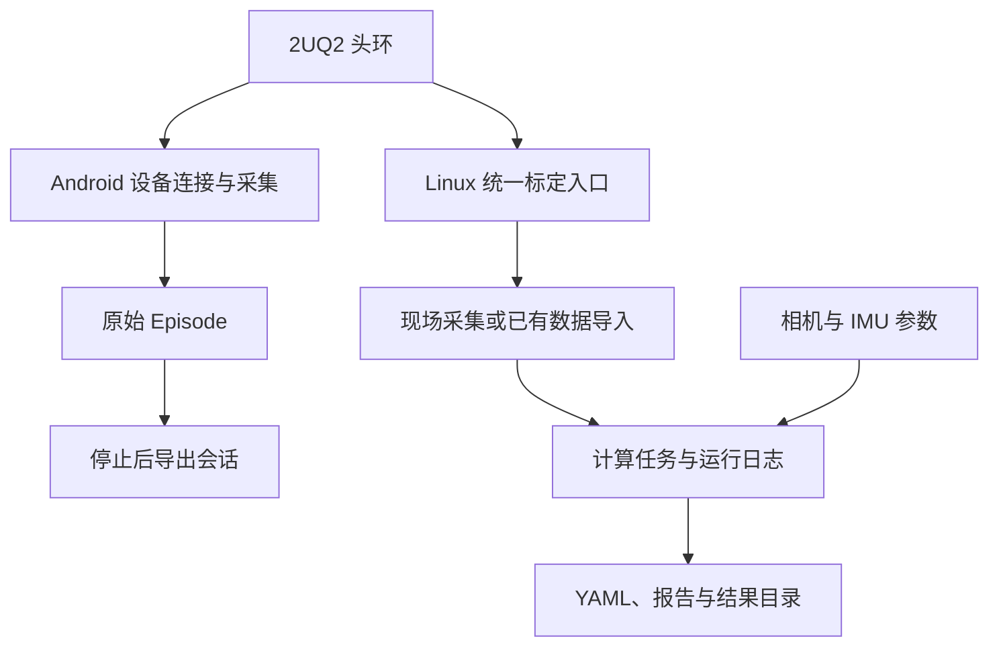

# 架构说明与审查（Architecture Review）

审查日期：2026-11-15。依据 Android code20 构建源码提交 `2cfe1d7b8ceac0884c5547eaec9e0044ef9563a5`、Linux PROCESS-WAIT 统一工具，以及当前部署脚本与文档。本文是源码与文档结构审查，不新增真机性能或标定精度结论。

## 1 结论与责任边界（Scope）

**两个应用、两个职责明确的源码仓库适合当前工作流。** Android 负责手机 USB 采集与文件导出；Linux 工具在同一个 App 内完成三种标定。没有必要为了 Camera、IMU、Camera–IMU 再拆成三个用户应用，也没有依据在本轮引入微服务或重写求解算法。

| 组成 | 源码归属 | 维护规则 |
|---|---|---|
| 手机 App | Ego-Capture | USB、预览、采集、导出与 Android 生命周期 |
| 统一标定 App | Ego-Calib-Tools | Linux 采集/导入、计算任务、日志、结果与环境适配 |
| 算法与依赖 | Kalibr、ROS、Docker、Python 依赖及原有组件 | 记录版本和来源；本轮不改第三方求解算法 |
| 用户教程及配套入口 | Ego-Capture 的 docs | 一个主页导航，独立采集/标定 README；程序快照以源提交和校验追溯 |

## 2 数据流（Data Flow）

两条 USB 路径分别运行：日常手机会话不是直接通往 Linux 同步 BAG 的隐含接口。跨模块复用通过明确定义的数据文件与参数完成，不能只靠扩展名或同一个设备号判断兼容。

## 3 Android 实际实现（Android Modules）

以下文件相对 `app/src/main/java/com/egouvc/phone/`，按交付 code20 源码查看，不能把默认分支历史源码当成同版实现。

| 模块 / 文件 | 现有责任 | 审查判断 |
|---|---|---|
| `MainActivity.kt`、`ui/` | 页面渲染、权限与自动连接策略、生命周期 | 页面已有独立 UI/策略对象；当前无需仅为分层改写 UI 框架 |
| `usb/UsbDeviceManager.kt` 等 | 设备识别、授权和连接状态 | 与录制状态分别维护，区分已连接和正在采集 |
| `camera/UvcCameraSource.kt` | UVC 生命周期、回调及录制/预览连接 | 是设备流与业务控制的协调点，修改时重点检查关闭和重连 |
| `camera/LatestPreviewDelivery.kt` 等 | 最新帧预览交付 | 预览与正式保存分别处理，显示 FPS 不能当作保存 FPS |
| `recording/EpisodeRecorder.kt` | 控制执行器、视频写入、IMU/音频采集及停止后导出调度 | I/O 不直接放到 UI 或原始视频回调中；此文件职责较集中，后续按变化需要拆分 |
| `recording/RecordingJobState.java` | STARTING → RECORDING → FINALIZING → EXPORTING → COMPLETE / FAILED | 本地保存任务与当前 USB 代次分开，保留上次结果；有利于停止后断连处理 |
| `export/StereoEpisodeExporter.kt` | 读原始索引，成对拆分 JPEG、写 MKV、时间及 IMU、副本与状态 | 临时目录与最终目录分开；异常帧记录不能被“成功”总状态掩盖 |
| `export/EgoRecordFormat.java` 等 | 文件名、时间格式、名义 IMU 换算等数据契约 | 数据解释应集中维护，文档和消费者跟随同一契约 |

`MainActivity.onStop()` 会关闭相机入口，因此当前前台采集约束有源码依据。若以后要求锁屏/后台持续采集，需要单独设计服务生命周期并实测；不能只改 README 宣称支持。

## 4 Linux 实际实现（Calibration Modules）

文件位于 Ego-Calib-Tools 的 `ego_stereo/camera_easy/`。`camera_easy` 是历史目录名，当前提供统一三模块入口。

| 模块 / 文件 | 现有责任 |
|---|---|
| `web.html`、`flow.js`、`existing.js` 等 | 模块选择、预览旁录制控制、参数拖放、已有数据入口与进度 |
| `app.py` | 绑定本机 `127.0.0.1` 的 HTTP 服务、设备任务及状态协调 |
| `hardware.py`、`imu_capture.py`、`joint.py` | 设备图像、静止 IMU 与联合现场录制 |
| `data_import.py`、`parameters.py` | 分段导入、文件与大小约束、参数持久化 |
| `offline.py` | 已有录制发现、独立结果目录、后台计算任务与状态/日志 |
| `pipeline.py`、`bag_writer.py`、`camera_bag_check.py` | BAG 整理、输入检查、相机计算与过程日志 |
| `joint_bag.py`、`joint_trial.py`、`joint_fixed_check.py` | 联合数据准备、求解及可选固定参数复核 |
| `imu_analysis.py`、`imu_experimental.py` | 静止噪声分析、条件候选与明确标记的实验权重 |
| `environment.py`、`install.sh`、`build_installer.py` | Docker 环境、安装、程序归档与桌面入口 |

该结构适合本机、单设备、交互式任务；不能直接视为已实现多设备并行调度、远程多用户服务或崩溃后自动续算。网页导入会复制到本机数据根目录，所以需要原文件之外的空间；不是只传一个路径引用。

## 5 审查发现与处理顺序（Findings & Actions）

| 优先级 | 发现 | 本轮处理 / 后续动作 |
|---|---|---|
| 使用入口 | 首页原先先讲架构/功能，硬件、打印、安装和第一次成功不连贯 | 已改为准备 → Release 下载安装包 → 打印 → 安装 → 使用 → 交付；源码克隆与轻量更新留在开发/备用说明 |
| 版本一致性 | code19 在功能分支，main 是较早源码；文档更新不会自动升级源码 | 明示 APK 对应分支及完整提交；合并功能代码应另做 PR，不混入文档改动 |
| 发布一致性 | 标定源码、程序 ZIP、校验、安装脚本及教程跨仓库关联 | 保留源提交与 BUILD_MANIFEST；升级时一起核对版本、校验和入口。尚未新增自动发布流水线 |
| 输入契约 | Camera、IMU、联合的重算输入不同，统一写“上传 BAG”会误导 | 主流程逐项列出；联合计算才依赖 Camera / IMU YAML；参数可后补 |
| 数据生命周期 | 原始记录、导入副本、计算结果会叠加占用空间 | 说明实际输出位置、导入复制与备份原则，不新增自动清理规则 |
| 状态与日志 | Android 录制器、Linux App 和已有任务各有协调状态 | 保留现有模块；下一轮如扩展任务类型，可评估统一任务接口和错误分类，先防止新增分支重复状态逻辑 |
| 数据版本 | 文件契约分布在导出器、Python 输入检查和文档 | 后续可集中维护机器可读 schema/version 与跨端契约检查；当前不宣称已经统一 |
| 开源发布 | 顶层统一许可证缺失，板 ZIP 未附完整生成/许可记录 | 由维护者明确项目及第三方再分发许可；本次不擅自选择许可证 |

没有从这次静态审查得出“当前全部并发、异常恢复和硬件时序均无问题”的结论，也不把代码行数本身当作缺陷。后续重构应由具体变化或复现问题驱动，保留原始数据契约与针对性回归检查。

## 6 文档如何维护（Documentation Architecture）

主页回答项目是什么、准备什么、怎么下载、怎么开始；硬件 README 负责装配与连接；采集 README 负责手机会话；标定 README 负责三个模块和输入/输出；数据格式、验证记录、开发及本架构说明供需要进一步了解的读者查阅。

用户提供的飞书手写教程作为表达与操作顺序参考：保留按动作解释、文件用途和完成条件的写法，更新其中旧安装路径、预热、两小时硬门限和“联合入口未整理”等历史状态。未把飞书内的工作站私有路径作为公开安装前提，也未修改飞书原文。

[项目总览（Project Overview）](../../../README.md) · [开发说明（Development Guide）](DEVELOPMENT.zh-CN.md) · [数据格式（Data Formats）](DATA_FORMAT.zh-CN.md)
