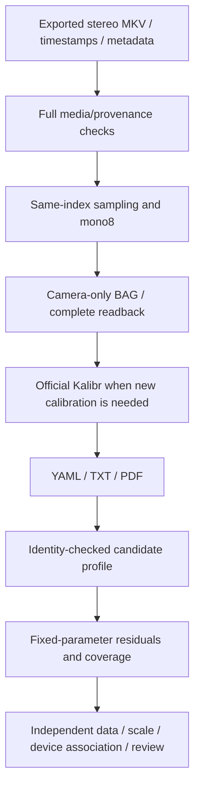

# 2UQ2 Ego stereo calibration tools

[Chinese guide and complete commands](README.zh-CN.md) · [Validation/handoff](STATUS-20261106.md)

Branch: `feat/ego-stereo-calibration`. This adds an isolated `ego_stereo/` directory for the Android 2UQ2 headband; existing four-camera preview, tools and daily workflow remain unchanged. Companion recorder: [Ego-Capture code16](https://github.com/EgoOneLabs/Ego-Capture/tree/feat/android-capture-code16).

| Module | Purpose |
|---|---|
| `media/` | Decode exported MKV/WAV; verify timestamps and source integrity; optional explicitly selected ADB pull |
| `workflow/` | Paired same-index sampling, mono8 images, camera-only ROS1 BAG write/full readback, official Kalibr launcher |
| `result_import/` | Import the known historical DS candidate with YAML/TXT/PDF association checks; never activate automatically |
| `quality/` | Fixed-intrinsics/fixed-stereo-extrinsics mono and bidirectional cross-projection audit on the known original 230 pairs |
| `evidence/` | Numeric summary from the reviewed workstation run; no footage, scenes, signing keys or BAG files |

Runtime: workstation Python3, FFmpeg, Docker; existing `kalibr` container with ROS Noetic, `/catkin_ws`, NumPy/OpenCV/cv_bridge/rosbag/Kalibr bindings, and the verified data bind mount. Official Kalibr sources and calibration algorithms are not modified. Every run uses a new output directory and preserves its evidence. Check physical target dimensions before calibrating new input (historical target: 6×6 AprilGrid, 0.088 m tags, gap/tag ratio 0.3).

The known candidate importer and fixed-parameter audit intentionally lock to an existing DS result/data identity. They are not general production acceptance tools for arbitrary devices. Use `--help` for all entry points; the Chinese guide gives repository-relative commands. `DELIVERY_NOTES.zh-CN.md` files preserve historical ZIP instructions, not the current repository installation path.

Confirmed evidence: actual media readback; native ROS1 smoke BAG readback of 36 stereo pairs; original DS result association; fixed-parameter detections on 230/230 original pairs. Cross-projection RMS: 0.818/1.047 px (cam0/cam1), P95: 1.453/1.678 px. Rightmost 1/8 of cam1 lacks retained target corners. These images were used to fit the parameters, so this is not independent holdout validation. Intrinsics/extrinsics are not refitted during validation.

Remaining: independent-data validation, edge coverage, physical dimensions/unit association and hardware synchronization. The new Kalibr-launcher branch itself has not been exercised end-to-end on a new real target session. IMU continuity and camera–IMU repeatability are not accepted. Do not rerun completed calibration merely to populate a new wrapper.

Tests are independent unittest suites under `workflow`, `result_import` and `quality`; see the Chinese guide. Test dependencies are in `requirements-test.txt`, while real calibration uses the existing container.

## Architecture and output contract

| Stage | Outputs / success meaning |
|---|---|
| Media | `media_check.json`; MEDIA_READBACK_PASS is integrity, not calibration acceptance |
| Preparation | `left/`, `right/` PGM; `camera_manifest.json`, `camera.bag`, `bag_verification.json`; complete pixel/Header/time checks |
| Calibration | `camera-camchain.yaml`, `camera-results-cam.txt`, `camera-report-cam.pdf`, source/config/log/timing; OUTPUTS_COMPLETE_REVIEW_PENDING does not approve quality |
| Import | `camera_profile.json`, `original_results/`, provenance; quality/activation flags stay false |
| Audit | `quality_summary.json`, `corner_residuals.csv`, coverage and projection images, log/archive; completion remains review-pending |

Historical input is named `camera_4hz.bag`; newly prepared workflow input is `camera.bag`. Identical host callback timestamps do not establish exposure synchronization. Coverage-cell occupancy is not image-area coverage or a passing percentage. The audit fits only each frame's target pose, not intrinsics or stereo extrinsics.

## Maintainer handoff

Read the existing evidence before rerunning anything. Next, reuse a genuinely different existing target recording for one fixed-parameter check; confirm it is not a repackaging of the fitting images. Address missing edge observations, physical scale and unit/version association before claiming final quality. Exercise the new optimizer launcher when a new calibration is genuinely needed. Preserve logs, failed attempts and input hashes. Keep IMU timing/continuity and joint calibration as separate unfinished work. Generalizing known-data tools requires explicit inputs/provenance, not removal of SHA identity guards.
