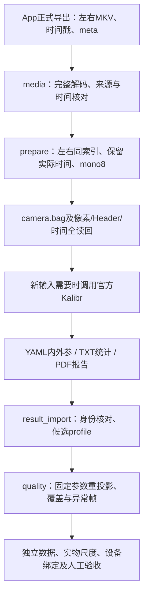

# 2UQ2 Ego 双目标定工具

[English](README.en.md) · [采集App](https://github.com/EgoOneLabs/Ego-Capture/tree/feat/android-capture-code16) · [本轮同步与验证](STATUS-20261106.md)

本目录在独立分支 `feat/ego-stereo-calibration` 保存安卓2UQ2双目采集的配套工具，不改动仓库原四鱼眼 `preview/`、`tools/` 和日常流程。相机模型沿用已有DS候选；官方Kalibr算法不修改，只封装准备、调用、验证和结果管理。不是手机端标定，也不是已完成量产验收的流程。

## 已集成的工具

| 目录 | 入口 | 功能 |
|---|---|---|
| `media/` | `check_session.py`、`pull_and_check.py` | 正式会话媒体/时间戳读回核验、可选ADB拉取 |
| `workflow/` | `camera_workflow.py prepare / calibrate` | 同索引左右抽帧、mono8、纯相机ROS1 BAG写入/全读回、官方Kalibr调用 |
| `result_import/` | `import_existing_calibration.py` | 导入已知历史DS候选，核对YAML/TXT/PDF身份及几何，不激活参数 |
| `quality/` | `run_quality.py` | 已知230对板图像的固定参数单眼/双向交叉重投影与覆盖核查 |
| `evidence/` | `quality_summary.json` | 已实际运行并独立复核的匿名数值统计；不包含原录像、BAG或现场人物图像 |

同目录的DELIVERY_NOTES是历史ZIP交付说明，以下仓库命令为部署入口。结果导入和quality工具目前锁定一份已知DS数据身份，不能直接当作任意新设备的通用验收命令。

## 系统架构与模块边界



quality调用官方AprilGrid与DS几何接口，仅估计每帧板姿态；内参/双目外参保持固定。当前导入器和核查器锁定已知历史结果，通用新设备入口尚未开发。App不内置历史结果展示，也未自动使用这些参数校正预览。

## Linux工作站准备

沿用现有 `kalibr` Docker容器、ROS Noetic、`/catkin_ws`，绑定挂载宿主数据目录到容器 `/data`。宿主需Python3、FFmpeg、Docker；容器已有Kalibr、OpenCV、NumPy、PyYAML、cv_bridge、rosbag等依赖。未使用GPU，不需要手机或头环参与离线处理。

```bash
git clone --branch feat/ego-stereo-calibration https://github.com/EgoOneLabs/Ego-Calib-Tools.git
cd Ego-Calib-Tools
```

### 1. 新正式板会话的媒体验证

以下两处路径【每次修改】，输出目录必须不存在；已验收的同条数据不必重复执行。

```bash
python3 ego_stereo/media/check_session.py \
  --session /实际/正式导出会话 \
  --output /实际/新的媒体核验目录
```

可选ADB拉取入口 `python3 ego_stereo/media/pull_and_check.py --help`。必须显式提供实际 `--serial` 与 `--remote-session`，仓库不预设个人手机序列号。该入口不删除手机数据。

### 2. 从实际标定板会话准备纯相机BAG

【每次修改】会话和MEDIA_READBACK_PASS报告路径。`purpose=smoke`只能核验通路，不允许执行标定；这里的calibration应为真正的标定板录制。

```bash
python3 ego_stereo/workflow/camera_workflow.py prepare \
  --session /实际/正式板会话 \
  --media-report /实际/媒体核验目录/media_check.json \
  --purpose calibration \
  --output-root /实际/容器可写挂载数据目录/2uq2_camera
```

同索引选择左右图像，默认最多4Hz，保留真实时间，不补帧、不缩放；生成左右1920×1080 mono8，话题 `/cam0/image_raw`、`/cam1/image_raw`，不含IMU。BAG像素、Header与时间逐条全读回。

### 3. 仅对尚未标定的新输入调用官方Kalibr

【每次修改】prepare打印的输出目录；【每次核对】实际6×6 AprilGrid黑色tag边长0.088m、间隙0.0264m，因此tagSpacing=0.3。已有DS结果不应仅因工具入库而重跑。

```bash
python3 ego_stereo/workflow/camera_workflow.py calibrate \
  --root /实际/camera_calibration_输出目录 \
  --model ds-none \
  --tag-size-m 0.088 --tag-spacing 0.3 --cols 6 --rows 6 \
  --confirm-calibration-inputs
```

核对容器挂载和官方受版本控制源码未修改，记录commit、image、输入摘要、日志及real/user/sys；不自动切模型或填焦距556。一次新目录只尝试一次，原输出保留。生成三文件只表示输出齐全，不自动通过质量验收。

### 4. 已有DS候选的导入与固定参数核查

下面两个命令仅适用于已经确认的历史2UQ2候选及原230对图像。原导入与核查已完成，保留用于复现，不要求现在重复执行。

```bash
python3 ego_stereo/result_import/import_existing_calibration.py --help
python3 ego_stereo/quality/run_quality.py --help
```

导入工具保留未验收、未激活、设备唯一编号未绑定等状态；固定参数工具在容器内调用官方AprilGrid/DS几何和每帧板位姿接口，由离线适配器计算单眼/交叉残差，并非直接运行官方GUI校验器。它不优化内参/双目外参、不改原BAG。

## 输出格式与状态如何解释

| 阶段 | 主要输出 | 状态的含义 |
|---|---|---|
| 媒体核查 | `media_check.json` | `MEDIA_READBACK_PASS`只确认媒体/来源/时间文件检查，不是标定质量通过 |
| 图像/BAG准备 | `left/`、`right/`的PGM，`camera_manifest.json`、`camera.bag`、`bag_verification.json` | `CAMERA_BAG_READBACK_PASS`确认像素、Header和时间一致；smoke不能执行标定 |
| 官方Kalibr调用 | `camera-camchain.yaml`、`camera-results-cam.txt`、`camera-report-cam.pdf`、日志/来源/real-user-sys | `OUTPUTS_COMPLETE_REVIEW_PENDING`仅表示优化退出及文件齐全，质量待人工复核 |
| 历史候选导入 | `camera_profile.json`、`original_results/`、导入说明和小归档 | 维持`calibration_quality_accepted=false`、`activated_in_android_app=false` |
| 固定参数核查 | `quality_summary.json`、`corner_residuals.csv`、覆盖图、角点叠加图、日志/小归档 | `FIXED_PARAMETER_AUDIT_COMPLETE_REVIEW_PENDING`表示核查执行完成，不是最终验收 |

左右使用同一输出帧索引并保留宿主回调时间，不能仅凭相同Header时间宣称硬件曝光同步。历史原数据为`camera_4hz.bag`；新workflow输出名为`camera.bag`，不要混用文件身份。网格非空比例不是面积覆盖率；有符号均值近0不是L2误差近0。

## 已有证据与剩余事项

- 正式媒体：左右各286帧完整解码、WAV非全零，视频PTS与文本相对时间最大差999999ns；最大相邻帧间隔67.387604ms，不宣称恒定30FPS或曝光同步。
- 原生ROS BAG：36对/72条mono8消息的像素与Header/时间全读回通过；该短记录用途为smoke，不是标定精度验证。
- 历史DS：230对图像；YAML/TXT/PDF一致；基线约89.27mm。固定参数230/230对均检测成功，交叉RMS左0.818、右1.047px，P95左1.453、右1.678px；real/user/sys约66.381/51.352/15.042秒。
- 右眼最右1/8区域无保留角点，边缘精度未证实。230对数据参与过拟合，本轮不是独立留出验证；不得把网格非空比例当作面积覆盖率或验收通过率。
- 新封装Kalibr优化调用分支尚未在新真实板会话端到端运行；不修改官方算法，不为验证新封装而盲目重录/重跑。
- 下一步优先复用另一次已有板录制，固定参数验证泛化；设备编号绑定、实物尺寸、全画幅质量和硬件同步仍需相应证据。IMU连续性和联合标定不是本分支已解决事项。

## 接手顺序与未完成事项

| 顺序 | 事项 | 已知约束与所需证据 |
|---|---|---|
| 1 | 阅读既有结果，不重跑原230对 | 原DS文件身份、几何和固定参数核查已完成；先看`evidence/quality_summary.json`和阶段记录 |
| 2 | 复用另一条已有板录制 | 固定参数验证一次，先确认不是原拟合数据的重复打包；不重新拟合、不扫描模型 |
| 3 | 边缘与全画幅质量 | 右眼最右1/8缺保留角点；先看已有素材，必要时才补采缺失覆盖 |
| 4 | 实物板尺度/设备关联 | 记录实物尺寸、头环唯一身份、左右对应及参数版本；不能只靠数值重投影证明尺度 |
| 5 | 新启动器端到端 | 下一次确需新标定时验证官方调用封装；不为工具换入口而重跑既有结果 |
| 单独专项 | IMU与硬件同步 | 与采集App协作，计数连续性、逐样本时间、联合标定重复性保留未验收 |

同一数据只做缺失证据的必要验证；失败保留日志，不覆盖旧结果。新增通用设备支持时，应增加显式输入与来源链，而不是去掉历史SHA守卫。正式质量阈值应由实际用途约定，当前工具没有自动批准参数的功能。

## 本地测试

### 仓库运行文件完整性（2026-11-07）

```bash
python3 ego_stereo/verify_checkout.py
```

历史 DS YAML、匹配 PDF/TXT 和摘要已随仓库保存在
`reference/2uq2-ds-20261102/`，导入器默认从这里读取；标定板示例在
`configs/aprilgrid_6x6_88mm.yaml`。不再要求先下载旧交付 ZIP 或读取作者的
`/home/key/Downloads`。这些参数仍为特定历史设备的候选，未激活、未自动验收。

所有拉取/准备/导入/核查入口现在要求显式 `--output-root`；固定参数核查还要求
显式 `--bag`，保留已知历史来源 SHA 守卫。真实录制是运行输入，不是 App
运行依赖；本次不包含真实工作场景 BAG，没有声称已发布其下载地址。

```bash
# 【每次修改】输出目录与原始BAG实际路径。
python3 ego_stereo/result_import/import_existing_calibration.py \
  --output-root /实际/新候选导入目录
python3 ego_stereo/quality/run_quality.py \
  --bag /实际/原230对图像/camera_4hz.bag \
  --output-root /实际/容器可写挂载数据目录/quality
```

完整文件分类、外部工具与数据边界见 [本地文件说明](LOCAL_FILES.md)。

宿主测试依赖见 `requirements-test.txt`；实际ROS/Kalibr依赖仍来自原容器。分别运行，避免同名模块跨目录串用：

```bash
python3 -m unittest discover -s ego_stereo/workflow -p test_workflow.py -v
python3 -m unittest discover -s ego_stereo/result_import -p test_import.py -v
python3 -m unittest discover -s ego_stereo/quality -p test_core.py -v
```
